# 네트워크 보안 검증 증빙

ALEPH-A-Class의 Web·DB·Mail 서버를 GNS3에 배치하고, 서버의 역할에 맞게 접근 경로와 전송 방식을 구성했습니다. Cisco ASAv로 Outside·DMZ·Inside를 분리하고, Apache의 WAF와 HTTPS, SMTP STARTTLS, 서버별 방화벽을 적용한 뒤 동작을 확인했습니다.

[앱 보안 재현·검증](../앱보안/앱보안_재현검증정리.md)은 서버가 `192.168.10.0/24`에 있던 시점의 기록입니다. 네트워크를 분리한 뒤에는 Web을 DMZ의 `192.168.20.111`에, Mail과 DB를 Inside의 `192.168.30.112`와 `192.168.30.113`에 배치했습니다. 상세 설정은 [설정 발췌](../부록_설정발췌.md)에 있습니다.

## 1. 네트워크 영역 분리 (Cisco ASAv)

### 개요

외부 사용자는 Web으로 접속하고, DB와 Mail은 Web에서 필요한 포트로만 접근하도록 영역 간 통신을 구성했습니다.

### 재현 과정

Outside의 Kali에서 `curl`과 `nc`로 Web과 DB의 포트에 접속했습니다. ASA의 `packet-tracer`로 정책 판정을 확인하고, 실제 요청에 대한 거부 로그는 `show logging`에서 조회했습니다. 두 번째 Outside 호스트에서도 Web·DB·Mail에 접속해 결과를 비교했습니다.

### 원인

초기에는 Web·DB·Mail이 같은 대역에 있었습니다. 외부 시험 호스트와 서버가 같은 네트워크에 있으면 역할별로 통신을 제한할 영역 경계가 없습니다.

### 보완 방법

Outside(`192.168.10.0/24`), DMZ(`192.168.20.0/24`), Inside(`192.168.30.0/24`)를 ASA 인터페이스로 분리했습니다. Outside에서는 Web의 TCP 80·443과 시험 호스트 `192.168.10.121`의 ICMP echo를 허용했습니다. DMZ에서는 Web에서 DB의 TCP 3306과 Mail의 TCP 25로 향하는 연결을 허용했습니다. Outside와 DMZ의 인바운드 ACL은 목록에 없는 신규 연결을 암묵적으로 거부합니다.

```text
# OUTSIDE_IN: Outside(192.168.10.0/24)에서 Web으로 허용하는 트래픽
access-list OUTSIDE_IN extended permit icmp host 192.168.10.121 host 192.168.20.111 echo
access-list OUTSIDE_IN extended permit tcp 192.168.10.0 255.255.255.0 host 192.168.20.111 eq www
access-list OUTSIDE_IN extended permit tcp 192.168.10.0 255.255.255.0 host 192.168.20.111 eq https
# Outside에서 DB·Mail로 향하는 신규 연결은 암묵적으로 거부

# DMZ_IN: Web에서 Inside로 나가는 트래픽만 예외적으로 허용
access-list DMZ_IN extended permit tcp host 192.168.20.111 host 192.168.30.113 eq 3306
access-list DMZ_IN extended permit tcp host 192.168.20.111 host 192.168.30.112 eq smtp

access-group OUTSIDE_IN in interface outside
access-group DMZ_IN in interface dmz
```

### 결과 캡처 (토폴로지 및 ASA 정책)

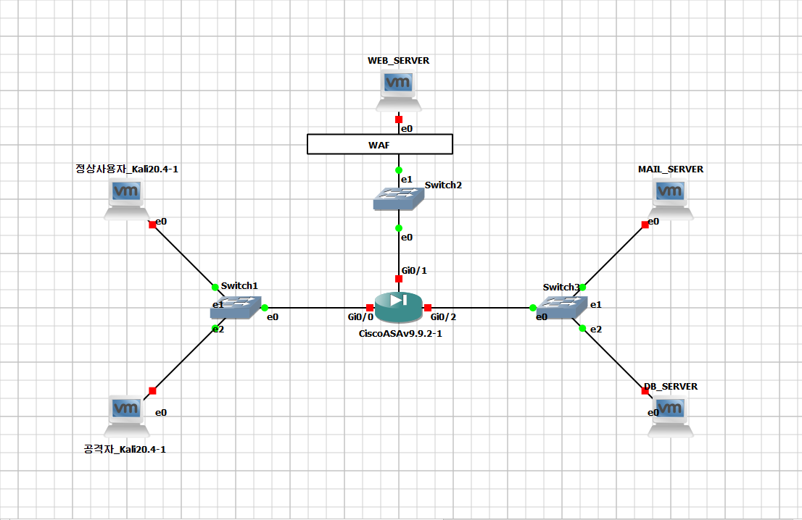
*ASA를 중심으로 Outside·DMZ·Inside를 분리한 GNS3 구성.*

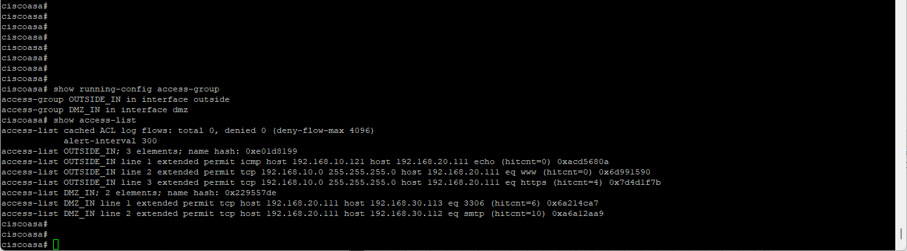
*`OUTSIDE_IN` 규칙 3개와 `DMZ_IN` 규칙 2개, 적용 인터페이스를 확인했습니다.*

### 결과 캡처 (첫 번째 Outside 호스트 및 Web 서버)

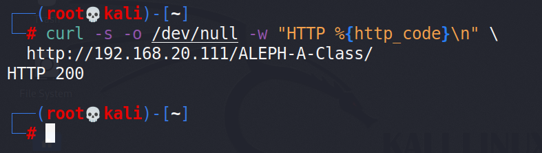
*Outside의 Kali에서 Web에 요청해 HTTP 200 응답을 받았습니다.*

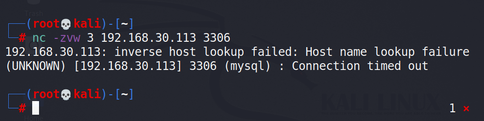
*Outside에서 DB로 연결을 시도했을 때 시간 초과가 발생했습니다.*

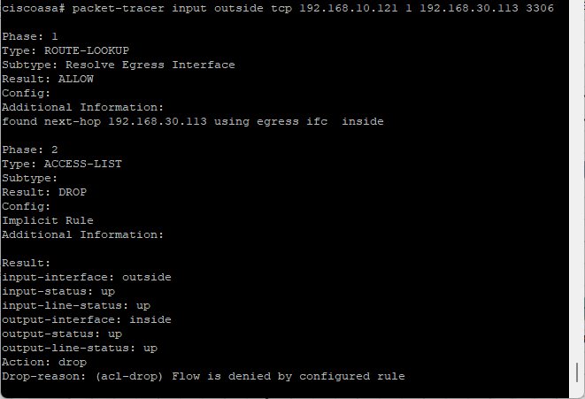
*`packet-tracer`에서 DB 3306으로 향하는 패킷이 Outside 인바운드 ACL의 암묵적 규칙에 의해 거부됐습니다.*

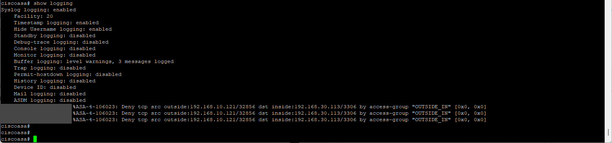
*ASA 로컬 로그의 `%ASA-4-106023`에서 Outside의 DB 3306 접속 시도가 거부된 것을 확인했습니다.*

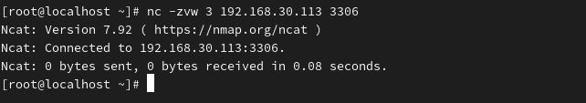
*Web에서 `192.168.30.113:3306`으로 TCP 연결이 수립됐습니다.*

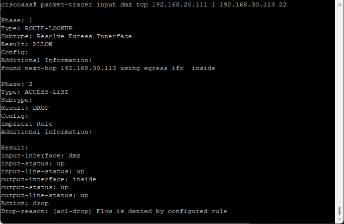
*`packet-tracer`에서 Web이 DB의 SSH 포트로 보내는 패킷을 DMZ 인바운드 ACL이 거부했습니다.*

### 결과 캡처 (두 번째 Outside 호스트)

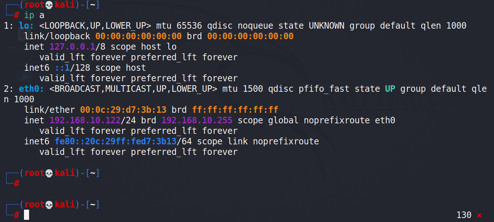
*두 번째 시험 호스트의 `eth0` 주소는 `192.168.10.122/24`입니다.*

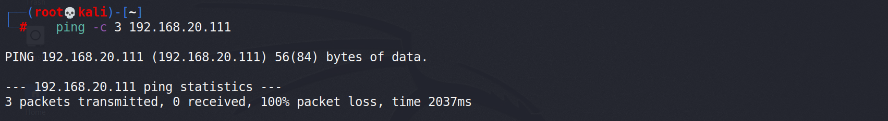
*ICMP 허용 목록에 없는 두 번째 호스트에서 Web으로 보낸 echo 요청 3개에 응답이 없었습니다.*

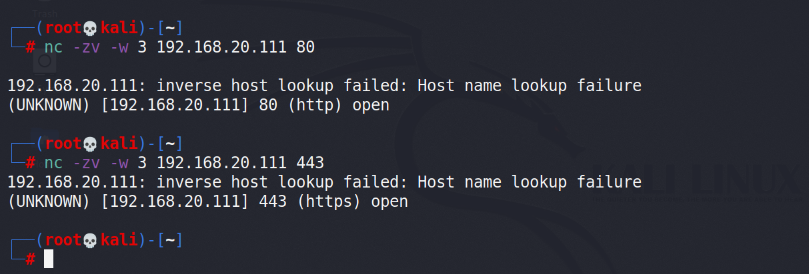
*Web의 TCP 80과 443에서 모두 `open`을 확인했습니다.*

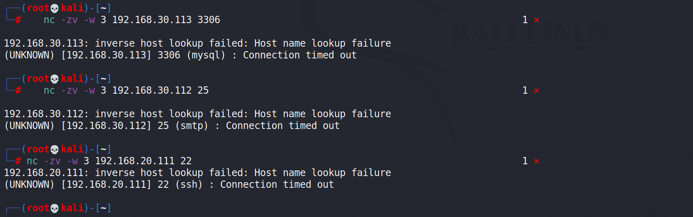
*DB 3306, Mail 25, Web 22로의 TCP 연결 시도에서 각각 시간 초과가 발생했습니다.*

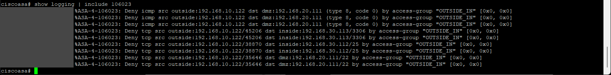
*`OUTSIDE_IN`이 `192.168.10.122`의 ICMP 요청과 TCP 3306·25·22 접속을 거부한 기록입니다.*

---

## 2. 웹 요청 검사 (ModSecurity와 OWASP CRS)

### 개요

외부에 공개한 Web 서비스의 HTTP 요청을 검사하기 위해 Apache에 ModSecurity와 OWASP CRS를 적용했습니다.

### 재현 과정

SQL Injection과 XSS 시험 요청을 각각 전송하고, 클라이언트의 HTTP 상태 코드와 ModSecurity 감사 로그를 확인했습니다. XSS 요청은 `unique_id`를 기준으로 탐지 규칙과 최종 차단 기록을 대조했습니다.

### 원인

ASA의 인바운드 ACL은 주소와 포트를 기준으로 연결을 제어합니다. 허용된 Web 연결을 통해 전달되는 SQL 구문이나 스크립트 문자열은 Apache에서 HTTP 요청을 검사하는 단계에서 처리했습니다.

### 보완 방법

Web 서버의 Apache 모듈로 ModSecurity를 로드하고 OWASP CRS를 적용했습니다. 최종 설정은 `SecRuleEngine On`이며, 토폴로지의 WAF 표시는 Web 서버 내부 모듈을 나타냅니다. 애플리케이션 코드에서는 별도로 Prepared Statement와 출력 이스케이프를 적용했습니다.

### 결과 캡처 (SQL Injection 차단)

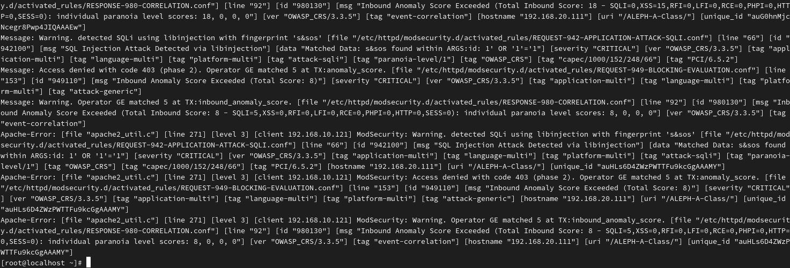
*SQL Injection 시험 요청이 OWASP CRS 규칙 942100에 일치했습니다.*

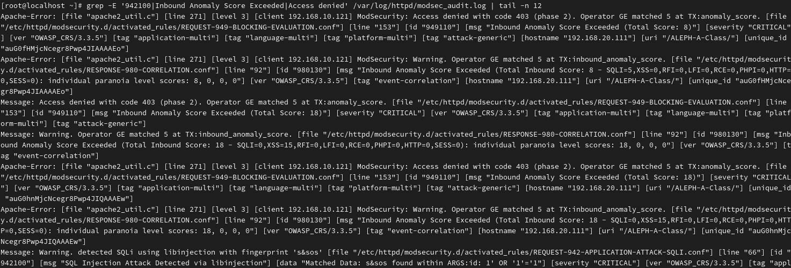
*감사 로그에서 `Access denied with code 403` 응답을 확인했습니다.*

### 결과 캡처 (XSS 차단)

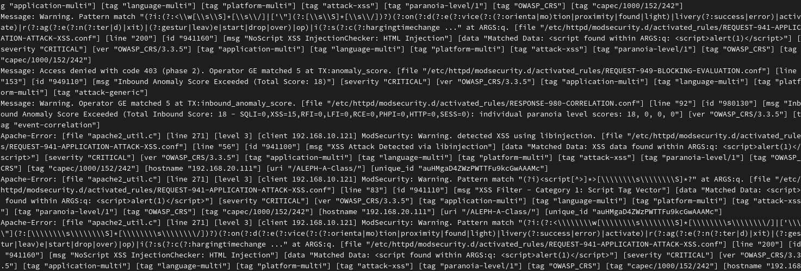
*XSS 시험 요청이 규칙 941100·941110·941160에 일치했습니다.*

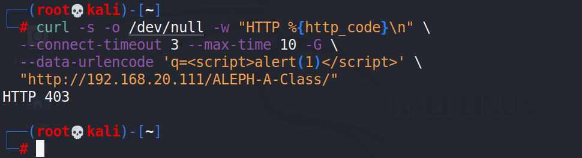
*지정한 XSS 요청에 대해 HTTP 403이 반환됐습니다.*

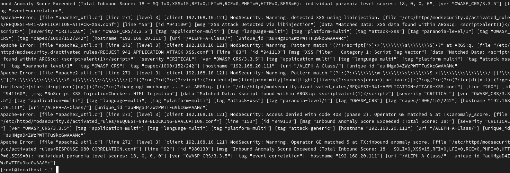
*같은 `unique_id`에서 탐지 점수 18을 기록했고, 규칙 949110이 요청을 차단했습니다.*

---

## 3. HTTPS 및 세션 쿠키 설정

### 개요

브라우저와 Web 서버 사이에 TLS를 적용하고 세션 쿠키가 HTTPS에서 전송되도록 설정했습니다.

### 재현 과정

`openssl x509`와 `httpd -S`로 인증서와 가상 호스트를 확인했습니다. `curl`로 HTTP 리다이렉트와 HTTPS 응답 헤더를 조회하고, 브라우저에서 홈페이지 표시와 관리자 로그인을 확인했습니다.

### 원인

초기에는 로그인 요청과 세션 쿠키가 HTTP로 전송됐습니다. 통신 경로에서 패킷을 관찰할 수 있는 경우 계정 정보와 세션 값이 노출될 수 있었습니다.

### 보완 방법

Apache에 Web 서버 주소 `192.168.20.111`을 포함한 자체 서명 인증서를 적용했습니다. TCP 80의 요청을 HTTPS로 리다이렉트하고, PHP의 `includes/auth.php`에서 세션 쿠키에 `Secure`, `HttpOnly`, `SameSite=Lax`를 지정했습니다.

```apache
# /etc/httpd/conf.d/redirect-http.conf
<VirtualHost *:80>
    ServerName 192.168.20.111
    Redirect permanent / https://192.168.20.111/
</VirtualHost>

# /etc/httpd/conf.d/ssl.conf 가 참조하는 인증서 경로(기본 파일명을 그대로 사용)
SSLCertificateFile    /etc/pki/tls/certs/localhost.crt
SSLCertificateKeyFile /etc/pki/tls/private/localhost.key
```

```php
// /var/www/html/ALEPH-A-Class/includes/auth.php
session_set_cookie_params([
    'httponly' => true,
    'secure'   => true,
    'samesite' => 'Lax',
]);
```

### 결과 캡처 (인증서와 HTTPS 응답)

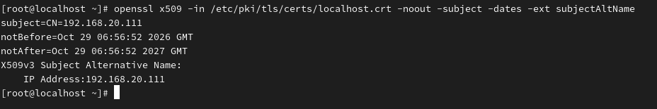
*인증서 유효기간과 CN·SAN의 Web 서버 주소를 확인했습니다.*

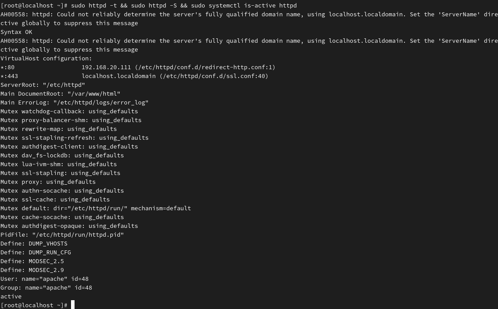
*Apache에서 80·443번 가상 호스트 설정을 로드했고 구문 검사에서 `Syntax OK`를 확인했습니다.*

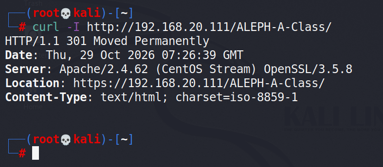
*HTTP 응답이 301이며 `Location` 헤더가 HTTPS 주소를 가리킵니다.*

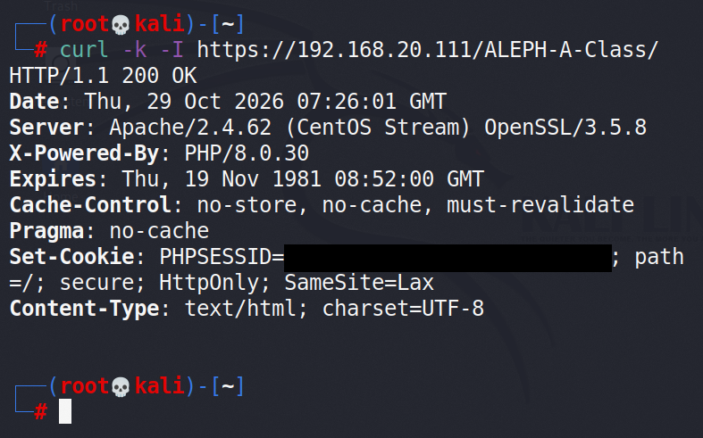
*`curl -k`로 인증서 신뢰 검사를 생략한 상태에서 HTTPS 200 응답과 쿠키 속성 `Secure`·`HttpOnly`·`SameSite=Lax`를 확인했습니다.*

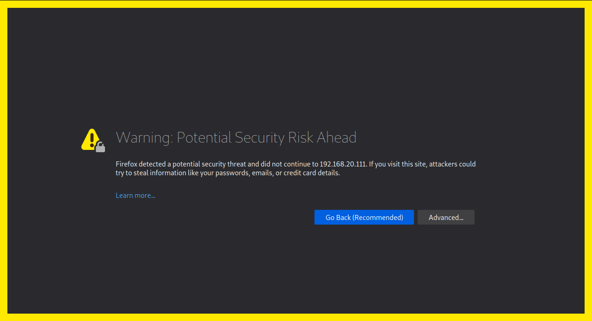
*브라우저가 자체 서명 인증서에 대한 신뢰 경고를 표시했습니다.*


*인증서 예외를 승인한 뒤 HTTPS에서 홈페이지가 표시됐습니다.*

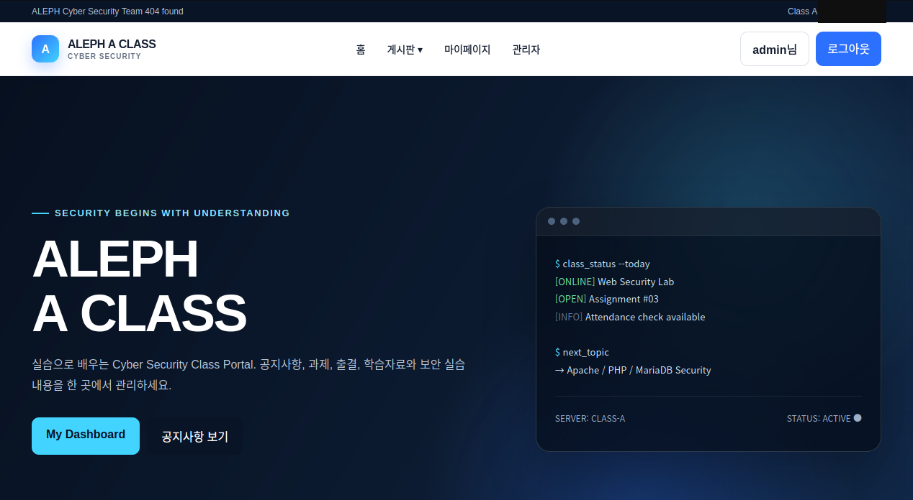
*HTTPS 연결에서 관리자 계정으로 로그인했습니다.*

---

## 4. 불필요한 서비스 비활성화

### 개요

Web 서버에서 웹 서비스와 관리에 필요한 포트를 기준으로 리슨 상태를 점검했습니다.

### 재현 과정

`ss -tuln`과 `systemctl`로 열린 포트와 유닛 상태를 조회했습니다. Samba와 NFS의 공유 설정은 각각 `testparm -s`와 `exportfs -v`로 확인했습니다.

### 원인

Web 서버에서 Telnet·TFTP 소켓과 파일 공유·탐색·인쇄 관련 서비스가 활성화돼 있었습니다. Samba의 `/tmp` 공유는 게스트 쓰기를 허용했고, NFS의 `/tmp`는 `192.168.10.0/24`에 읽기·쓰기로 내보내도록 설정돼 있었습니다.

### 보완 방법

Web 운영에 쓰지 않는 서비스와 소켓을 중지하고 `disable --now`로 부팅 시 자동 활성화를 해제했습니다. `rpc-statd`는 `static` 유닛이므로 중지 상태를 확인했습니다. Web·DB·Mail에 필요한 서비스와 관리용 SSH는 유지했습니다.

```bash
# 예시: Telnet
# Before — telnet.socket이 active/enabled, TCP 23 리슨 중
systemctl is-active telnet.socket    # active
systemctl is-enabled telnet.socket   # enabled

# 적용
systemctl disable --now telnet.socket

# After
systemctl show telnet.socket --property=ActiveState,UnitFileState
# ActiveState=inactive
# UnitFileState=disabled
```

### 결과 캡처 (보완 전·후)

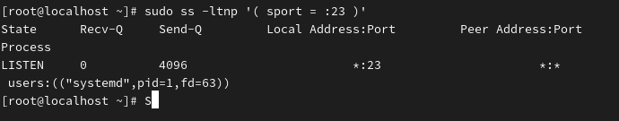
*TCP 23 리슨 상태를 확인했습니다.*

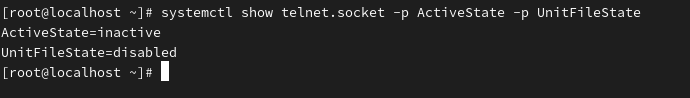
*`telnet.socket`은 `inactive`·`disabled` 상태입니다.*


*UDP 69 소켓이 열려 있었습니다.*

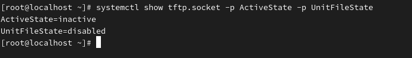
*`tftp.socket`은 `inactive`·`disabled` 상태입니다.*

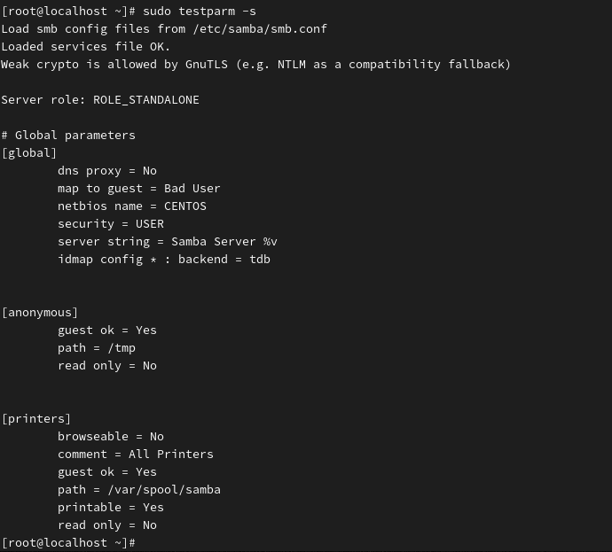
*`testparm -s` 출력에서 게스트 접근과 `/tmp` 쓰기 허용 설정을 확인했습니다.*

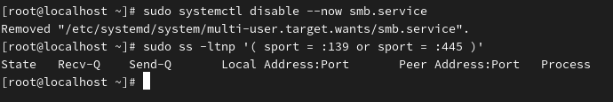
*서비스 비활성화 후 TCP 139·445 리슨 항목이 조회되지 않았습니다.*

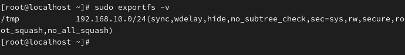
*`exportfs -v`에서 `/tmp` 읽기·쓰기 공유 설정을 확인했습니다.*

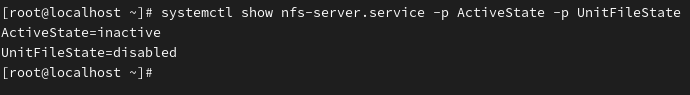
*`nfs-server`는 `inactive`·`disabled` 상태입니다.*

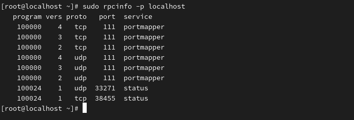
*`rpcinfo`로 portmapper와 등록된 RPC 서비스를 확인했습니다.*

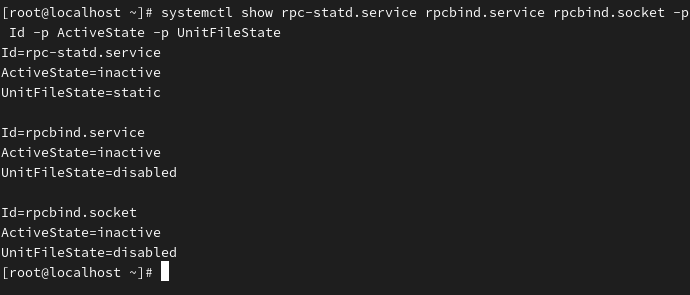
*`rpcbind.service`와 `rpcbind.socket`은 `inactive`·`disabled`, `rpc-statd`는 `inactive`·`static`입니다.*

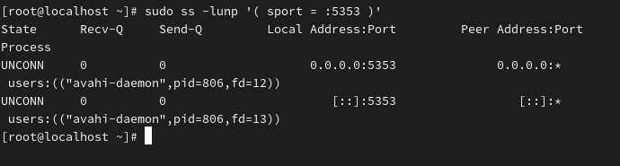
*mDNS용 UDP 5353 소켓이 열려 있었습니다.*

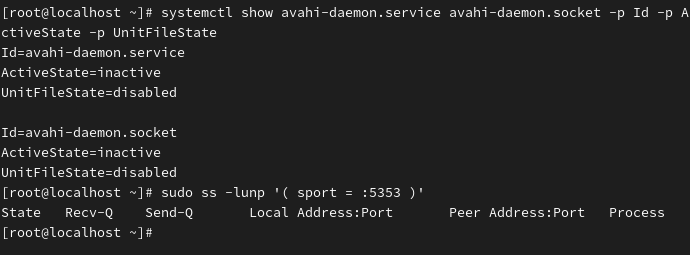
*Avahi 서비스와 소켓의 비활성 상태를 확인했습니다.*

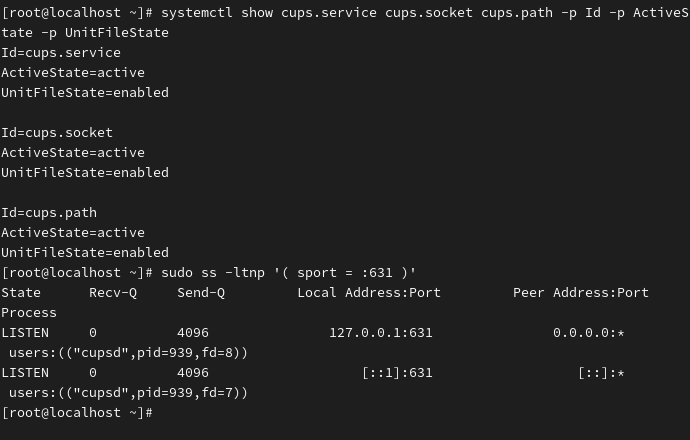
*CUPS가 활성 상태였고 TCP 631을 사용하고 있었습니다.*

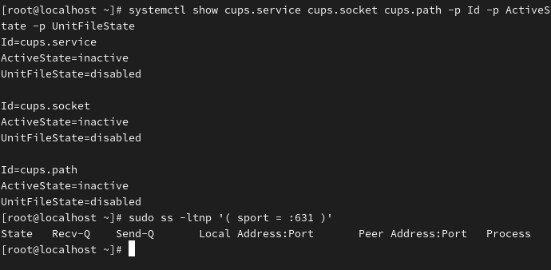
*CUPS 서비스와 관련 유닛의 비활성 상태를 확인했습니다.*

### 결과 캡처 (서버별 서비스와 포트)

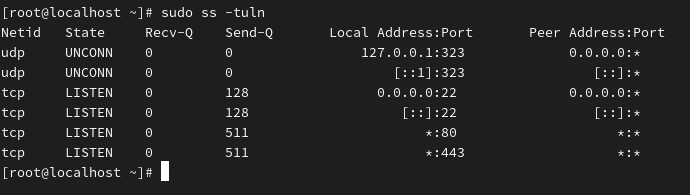
*TCP 리슨 포트는 SSH 22, HTTP 80, HTTPS 443입니다.*

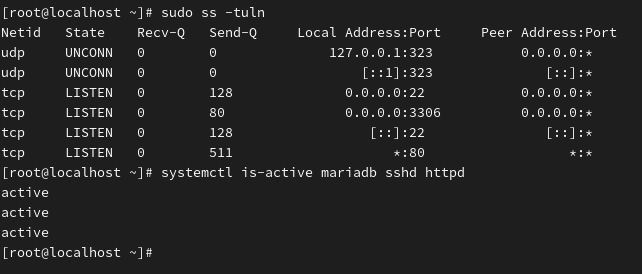
*`mariadb`·`sshd`·`httpd`의 동작과 TCP 3306·22·80 리슨을 확인했습니다.*

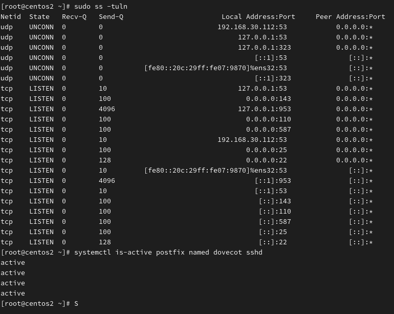
*`postfix`·`named`·`dovecot`·`sshd`의 동작과 메일·DNS·관리 포트의 리슨을 확인했습니다.*

---

## 5. SMTP STARTTLS 적용

### 개요

비밀번호 재설정 코드가 담긴 메일을 Web에서 Mail로 전달하는 구간에 STARTTLS를 적용했습니다.

### 재현 과정

보완 전 PHPMailer 설정을 조회했습니다. 보완 후에는 앱에서 재설정 메일을 발송하고 Postfix 로그에서 STARTTLS 사용과 Maildir 배달을 확인했습니다. Mail 서버 인증서 검증과 TLS 버전은 별도 Python 스크립트로 확인했습니다.

### 원인

보완 전 PHPMailer에서 `SMTPSecure`와 `SMTPAutoTLS`가 비활성화돼 있었습니다. 이 설정에서는 Web이 Mail에 보내는 SMTP 메시지와 인증코드가 평문으로 전달됩니다.

### 보완 방법

[PHPMailer 설정](../코드_비교/after/includes/mailer.php)에 STARTTLS를 지정하고, 실습용 CA 파일과 서버 이름을 사용해 Mail 서버 인증서를 검증하도록 구성했습니다. Postfix의 `smtpd_tls_security_level = may`는 클라이언트가 요청할 때 STARTTLS를 제공합니다.

```php
// includes/mailer.php (보완 후 실제 코드, 일부)
$mail->isSMTP();
$mail->Host       = '192.168.30.112'; // 실습용 메일 서버
$mail->Port       = 25;
$mail->SMTPAuth   = false;            // 인증 없음
$mail->SMTPSecure = 'tls';            // 암호화 tls
$mail->SMTPAutoTLS = true;

$mail->SMTPOptions = [
    'ssl' => [
        'verify_peer'       => true,
        'verify_peer_name'  => true,
        'allow_self_signed' => false,
        'cafile'            => '/etc/pki/tls/certs/aleph-mail-ca.crt',
        'peer_name'         => '192.168.30.112',
    ],
];
```

### 결과 캡처 (보완 전)

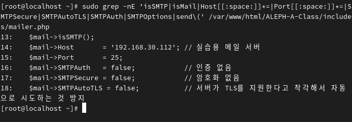
*`SMTPSecure=false`와 `SMTPAutoTLS=false`를 확인했습니다.*

### 결과 캡처 (보완 후)

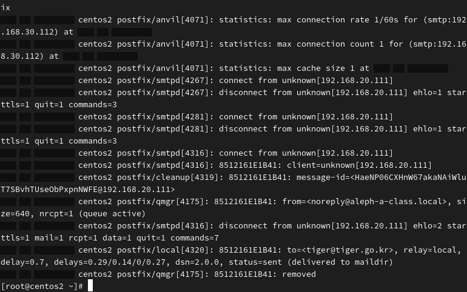
*Web에서 온 세션의 `starttls=1`과 큐 ID `8512161E1B41`의 `status=sent (delivered to maildir)`를 확인했습니다.*

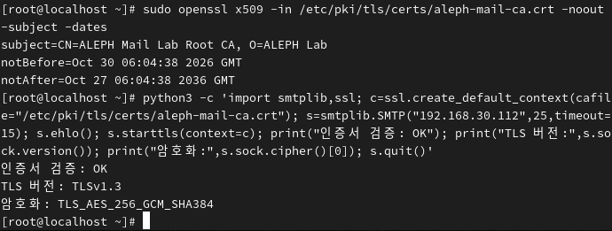
*별도 SMTP 연결에서 CA 인증서 검증을 통과했고 `TLSv1.3`과 `TLS_AES_256_GCM_SHA384`를 확인했습니다.*

---

## 6. 호스트 방화벽으로 같은 대역 내 통신 제한

### 개요

Inside에서 Mail과 DB가 서로의 업무 포트로 연결하지 못하도록 제한했습니다. Web에서 두 서버로 향하는 업무 연결은 유지했습니다.

### 재현 과정

Web과 Mail에서 각각 DB 3306에 접속하고, Web과 DB에서 각각 Mail 25에 접속했습니다. 출발지별 연결 결과와 각 서버의 `firewall-cmd --list-all` 출력을 대조했습니다.

### 원인

Mail과 DB는 같은 Inside 대역 `192.168.30.0/24`에 연결돼 있습니다. 두 서버 간 트래픽은 ASA를 경유하지 않으므로, 이 경로의 접근 정책은 목적지 호스트에서 적용했습니다.

### 보완 방법

DB와 Mail의 `firewalld`에 Web 주소 `192.168.20.111/32`를 출발지로 지정한 rich rule을 추가했습니다. DB는 TCP 3306, Mail은 TCP 25에 해당 규칙을 적용했습니다. `ssh`와 `dhcpv6-client` 등 기존 서비스 항목은 정책 출력에서 별도로 확인할 수 있습니다.

```bash
# DB 서버(192.168.30.113) — Web(192.168.20.111)에서만 3306 허용
firewall-cmd --permanent --add-rich-rule='
  rule family="ipv4"
  source address="192.168.20.111/32"
  port protocol="tcp" port="3306"
  accept'
firewall-cmd --reload

# Mail 서버(192.168.30.112) — Web(192.168.20.111)에서만 25 허용
firewall-cmd --permanent --add-rich-rule='
  rule family="ipv4"
  source address="192.168.20.111/32"
  port protocol="tcp" port="25"
  accept'
firewall-cmd --reload
```

### 결과 캡처 (DB 서버)

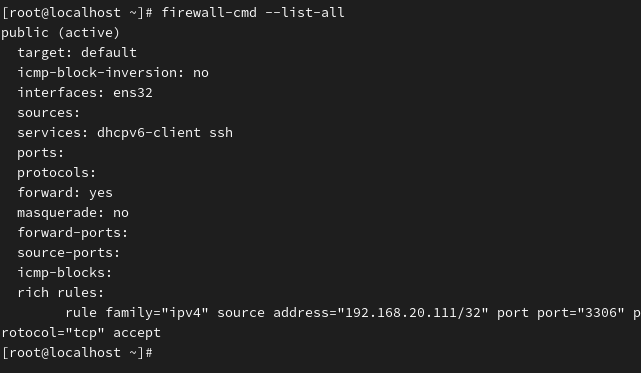
*Web에서 온 TCP 3306 연결을 허용하는 rich rule입니다.*

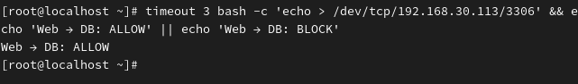
*Web에서 DB 3306에 연결됐습니다.*

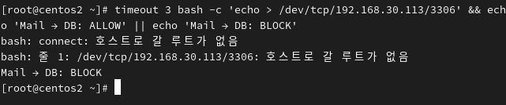
*같은 Inside의 Mail에서는 DB 3306 연결이 거부됐습니다.*

### 결과 캡처 (Mail 서버)


*Web에서 온 TCP 25 연결을 허용하는 rich rule입니다.*

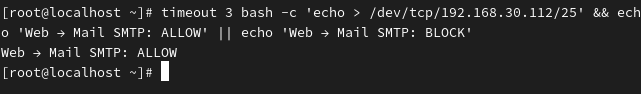
*Web에서 Mail 25에 연결됐습니다.*

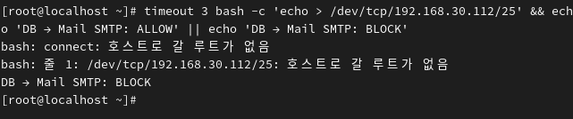
*같은 Inside의 DB에서는 Mail 25 연결이 거부됐습니다.*

### 결과 캡처 (Web 서비스 재검증)

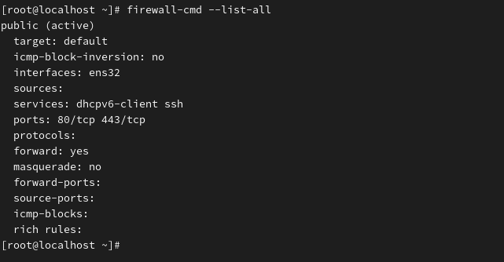
*TCP 80·443과 `ssh`·`dhcpv6-client` 서비스가 정책에 표시됩니다.*

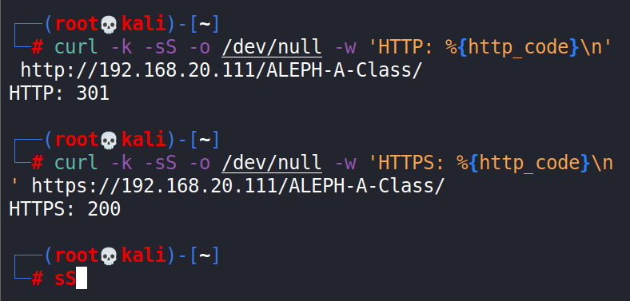
*호스트 방화벽 적용 후에도 HTTP 301과 HTTPS 200 응답을 확인했습니다.*

---

## 7. 재부팅 후 재검증

### 개요

Web·DB·Mail 서버를 재부팅한 뒤 서비스 상태와 방화벽 정책을 다시 확인했습니다.

### 검증 과정

`systemctl is-active`와 `systemctl is-enabled`로 서비스 상태를 확인하고, `firewall-cmd --list-all`로 적용된 정책을 조회했습니다. Web에서 Apache의 `security2_module`을 확인한 뒤 HTTPS로 SQL Injection과 XSS 시험 요청을 다시 보냈습니다.

### 결과 캡처


*`firewalld`·`mariadb`·`sshd`·`httpd`가 활성화됐고, Web에서 DB 3306에 접근하는 규칙이 유지됐습니다.*


*`firewalld`·`postfix`·`named`·`dovecot`·`sshd`가 활성화됐고, Web에서 SMTP에 접근하는 규칙이 유지됐습니다.*


*핵심 서비스 상태와 TCP 80·443 허용 정책, Apache의 WAF 모듈 로드를 확인했습니다.*


*HTTPS로 다시 전송한 SQL Injection과 XSS 시험 요청에 모두 HTTP 403이 반환됐습니다.*
